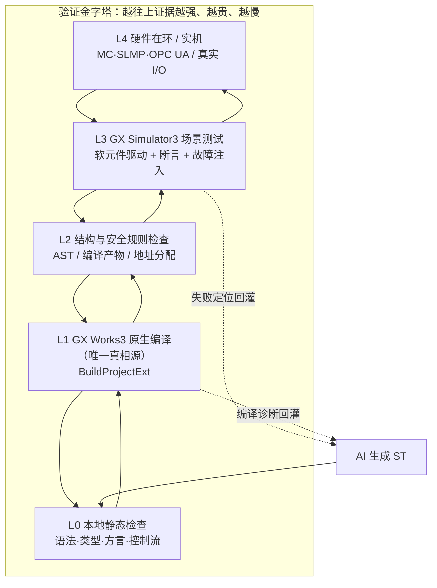

# 03 · 验证体系、行业实践与安全边界

> **目标方案**：三菱 PLC AI 编程（需求规格 → AI 生成 ST → 本地检查 → GX Works3 原生编译 → GX Simulator3 仿真 → 可选实机）
> **文档**：调研稿 v0.1 ｜ **作者**：domain-verify（Agent Team） ｜ **日期**：2026-11-10
> **基线**：`ai-st-gxworks3` v0.1；GX Works3 **1.128**；GXW3Call 类型库已 dump 于 [GXW3Call-API-raw.txt](GXW3Call-API-raw.txt)
> **边界声明**：本稿未启动 GX Works3、未执行任何 COM/仿真。凡涉及 GXW3Call 的结论均来自类型库签名与官方手册；需要实测的项一律标注〔测〕并汇总到附录 C。
>
> **证据分级（全文统一使用）**
>
> - 〔出〕**有外部出处**：可点开的公开资料（论文、标准、厂商文档），行文附链接；链接是"存在性证据"，不代表本稿逐字核对了原文全部结论。
> - 〔判〕**工程判断**：基于项目现实、公开资料的推理与设计取舍，没有直接出处，需方案评审时复核。
> - 〔测〕**待实测假设**：当前无法离线确认、必须在真实 GX Works3 1.128 / GX Simulator3 上做 spike 的命题（附录 C）。

---

## 0. 摘要（给决策者）

**一句话结论**：AI 生成 PLC 代码的工程价值不在"生成"，而在**可验证的生成**——把目前"人工导入 + 人工判断"的两段黑箱，替换成"可复现的编译–仿真–证据链"，同时把安全边界写进工具与流程。当前项目最大的技术风险不是模型能力，而是三件事：

1. **ST 程序体如何自动写入 GX Works3**（决定闭环能否全自动）；
2. **仿真闭环的时序可靠性**（决定 L3 行为测试是否可信）；
3. **安全功能的边界治理**（决定这套工具能不能进产线，而不只是 demo）。

### 0.1 十条结论

| # | 结论 | 证据 |
|---|---|---|
| 1 | 学界与工业界的共识是"编译通过 ≠ 行为正确"；2026 年已有专门做**逐扫描（scan-by-scan）**评测 LLM-PLC 程序的论文，标题即结论 | 〔出〕[Compilation Is Not Correctness](https://arxiv.org/abs/2610.28675) |
| 2 | LLM-PLC 研究已收敛为四类：知识增强助手、标准/编译器约束生成、闭环 Agent 验证、评测基准；**共同点是把验证当一等公民**，而不是生成后的补救 | 〔出〕[STARK](https://dl.acm.org/doi/full/10.1145/3796563.3796575)、[SCP](https://ieeexplore.ieee.org/document/11630913)、[Agents4PLC](https://arxiv.org/abs/2410.14209)、[LLM4PLC](https://arxiv.org/abs/2401.05443) |
| 3 | 西门子（TIA Openness + Test Suite）、CODESYS（Scripting + Test Manager + CfUnit）证明"工程 API + 测试框架 + CI"是全自动闭环的成熟形态；**三菱缺的是同级的程序体文本导入** | 〔出〕[TIA Openness](https://docs.tia.siemens.cloud/r/en-us/v20/tia-portal-openness-api-for-automation-of-engineering-workflows/)、[CODESYS Test Manager](https://store.codesys.com/media/n98_media_assets/files/2101000003-F/4/CODESYS%20Test%20Manager_en.pdf) |
| 4 | 建议采用**五层验证金字塔** L0→L4；L1（GX Works3 原生编译）是唯一真相源，**L2（结构/安全规则）与 L3（仿真场景测试）是本项目新增投入的重点**，也是相对 v0.1 的核心增量 | 〔判〕第 2 章 |
| 5 | L2 规则库是"最低成本的正确性护栏"：约 20 条规则可覆盖 AI 生成 PLC 代码的高频错误（双线圈、输出互锁、急停门控、FB 实例复用、定时器时基、除零、数组越界等） | 〔判〕2.4 |
| 6 | 测试用例 DSL 是产品核心资产，建议**先写用例、再写生成器**：用可执行用例反向约束 LLM 输出，比优化提示词修辞更有效 | 〔出〕[Benchmarking prompting techniques](https://www.sciencedirect.com/science/article/pii/S2666827025001872) +〔判〕第 3 章 |
| 7 | 评测指标里"**一次通过率（FTR）**"与"**人工返工分钟（MRO）**"比"编译通过率"更能反映真实价值；后者极易被修复循环"刷"高 | 〔判〕4.1 |
| 8 | 安全边界：程序分**红/黄/绿**三级，红级（急停、安全门、安全 PLC、危险能量直接控制）**禁止 AI 生成**，只能引用经认证的安全 FB/库；交付前建议 6 道人工/自动 gate | 〔判〕第 5 章 +〔出〕[ISO 13849-1](https://www.tuv.com/content-media-files/master-content/services/industrial-services/1048-tuv-rheinland-functional-safety-of-machinery/pdf/tuv-rheinland-de23_p04_mach_2300435_flyers-set_en_02.pdf) |
| 9 | 若面向 SIL/PL 项目，AI 生成器必须按"工具"处理（IEC 61508-3 工具评估），且**不能承担 V&V 独立性**；工具版本变更视同工具变更，需重新跑基准回归 | 〔出〕[IEC 61508 评注版](https://share.ansi.org/Shared%20Documents/News%20and%20Publications/Other%20Documents/IEC%2061508%20Commented%20Version.pdf) +〔判〕5.6 |
| 10 | 架构决策应延后到 3 个 P0 spike 之后再定：**ImportObjectCsv 对 ST 的往返可行性、仿真设备读写时序、StartSimulator 能否无人值守**（附录 C） | 〔测〕附录 C |

### 0.2 建议的落地节奏〔判〕

| 阶段 | 目标 | 关键交付 | 退出条件 |
|---|---|---|---|
| P0（1–2 周） | 证明闭环可行性 | 3 个 spike 报告（附录 C） | 至少找到一条"自动写入 ST 程序体"的可行路径，否则回到"半自动 babysit"架构 |
| P1（3–4 周） | 建 L2 + L3 骨架 | 20 条规则库、DSL v0.1、仿真 runner、10 个基准场景 | 10 个场景可端到端跑通并产出证据包 |
| P2（4–6 周） | 评测与回归 | 18 个基准场景、指标看板、失败分类法、holdout | 指标基线稳定（连续 3 轮波动 < 10%） |
| P3（持续） | 治理与交付 | 三色分级、6 道 gate、交付物模板、工具鉴定材料 | 通过一次内部"准生产"评审 |

---

## 1. 行业做法调研

### 1.1 学术侧：LLM 生成 PLC 代码已经形成四条路线

| 路线 | 代表工作 | 做法要点 | 对本项目的启示 |
|---|---|---|---|
| **A. 知识/领域增强助手** | STARK（ACM）、海事系统 FB 生成（JSS） | 把 PLC 领域知识、指令语义、既有 FB 库注入模型；强调推理链与知识检索 | v0.1 的"方言系统提示词 + 指令白名单"属于这一路线的轻量版；还可加"FB 语义卡 / 常见错误卡" RAG |
| **B. 标准/编译器约束生成** | Standard Conformant Prompting（IEEE）、提示技术基准（ScienceDirect 2025） | 以标准（如 PLCopen 规范、厂商手册）为约束生成"编译器可接受"的代码；把后验验证前移为"标准驱动综合" | 把 L0/L1 的规则**反写进生成约束**（约束解码/结构化输出/白名单），比事后 lint 更省 token |
| **C. 闭环 Agent 生成 + 验证** | Agents4PLC（arXiv 2410.14209）、LLM4PLC（arXiv 2401.05443） | LLM Agent 反复"生成→语法/语义检查→修复"，把验证器作为工具暴露给 Agent；LLM4PLC 强调语法约束 + 验证回路 | 这正是本项目要补的闭环；但要防止"修复循环掩盖一次通过率"（见 4.1） |
| **D. 评测与基准** | Compilation Is Not Correctness（2026）、prompting 基准论文 | 定义可复现的评测协议；强调编译通过不等于行为正确，主张逐扫描/逐用例评测 | 直接支撑本稿第 3、4 章：**行为用例必须成为验收口径** |

〔出〕上述工作链接：[STARK](https://dl.acm.org/doi/full/10.1145/3796563.3796575) ｜ [海事 FB 生成](https://www.sciencedirect.com/science/article/abs/pii/S0164121226002244) ｜ [SCP](https://ieeexplore.ieee.org/document/11630913) ｜ [提示技术基准](https://www.sciencedirect.com/science/article/pii/S2666827025001872) ｜ [Agents4PLC](https://arxiv.org/abs/2410.14209)（IEEE 版 [11410524](https://ieeexplore.ieee.org/document/11410524)）｜ [LLM4PLC](https://arxiv.org/abs/2401.05443) ｜ [Compilation Is Not Correctness](https://arxiv.org/abs/2610.28675)

**1.1.1 从学术侧能直接拿走的四条经验**〔判〕

1. **验证器必须作为"工具"暴露给生成循环**：把 L0/L1 的诊断文本原样回灌，比让模型"自我反思"有效得多（v0.1 已有 JSON 修复重试，可扩展到编译错误）。
2. **生成目标要"编译友好"而非"人类可读"**：受限语法子集 + 结构化输出，能显著减少方言类错误。
3. **评测必须逐用例、可复现**：学术论文都在补这块；工业产品的要求只会更严。
4. **警惕 benchmark 污染**：公开场景一旦进入提示词示例或训练语料，指标就不可信（见 4.6）。

### 1.2 一个必须接受的坏消息：编译通过率会被高估

`Compilation Is Not Correctness` 这个标题就是结论〔出〕[arXiv:2610.28675](https://arxiv.org/abs/2610.28675)。工业现场的对应现象是：一段 ST 在 GX Works3 里"0 error 0 warning"通过，但可能——

- 输出互锁缺失（正反转同时吸合）；
- 急停按下后输出不被门控（靠硬回路兜底，软件层面已违规）；
- 定时器时基选错（10 s 实际 100 s）；
- 首扫描未初始化导致误动作；
- 扫描周期被长循环拖爆导致看门狗复位。

这些**全部能通过编译**。所以本稿把 L1 定位为"必要不充分"的关口：它是唯一能证明"程序在目标编译器语义下成立"的自动化手段，但它**不是正确性证明**。正确性只能由 L2（结构规则）+ L3（行为用例）+ L4（实机）叠加逼近。

### 1.3 商业平台：四条可对照的自动化路径

| 平台 | 可编程接口 | 能否写入程序体 | 编译 | 仿真 | 自动化测试 | 对本项目的启示 |
|---|---|---|---|---|---|---|
| **Siemens TIA Portal** | TIA Openness（.NET API）〔出〕[文档](https://docs.tia.siemens.cloud/r/en-us/v20/tia-portal-openness-api-for-automation-of-engineering-workflows/) | 可导入外部 SCL 源文件、生成块 | Openness 触发编译 | PLCSIM Advanced | TIA Portal Test Suite（SCL 单元测试 + 应用测试）〔出〕[手册页](https://contentpath.siemens.com/c/tia-portal-testsuite-4pager) | **全自动闭环的参考形态**：官方 API 覆盖"写程序+编译+仿真+测试"全链 |
| **CODESYS** | Python Scripting Engine | 可通过脚本/PLCopen XML 操作工程 | 脚本触发编译 | CODESYS Control Win（软 PLC） | Test Manager + CfUnit（单元测试框架）〔出〕[CfUnit](https://forge.codesys.com/u/aliazzz/wiki/CfUnit%20v1.1.0.0/) | **测试框架产品化**的样板：脚本化用例 + CI 集成 |
| **PLCopen 生态** | PLCopen XML（IEC 61131-10）〔出〕[XML exchange](https://www.plcopen.org/standards/xml-echange/) | 标准交换格式 | 各厂商编译器 | 各厂商 | 一致性认证（Logic certification）〔出〕[PLCopen certification](https://www.plcopen.org/certification/logic/) | 跨工具解耦靠标准格式。**更正**：本仓库早期「导入后程序内容为空」是因为生成了 **PLCopen TC6_0201** 格式（`<project>` + plcopen 命名空间），与 GX Works3 期望的 **IEC 61131-10**（`<Project>` + `www.iec.ch/public/TC65SC65BWG7TF10`）不同；GX Works3 官方支持 IEC 61131-10 导入（本机样例 `SampleData\IEC61131-10XML\Sample.xml` + 手册附8 + 内嵌 XSD），根因待 `M9` 实验最终确认。详见 `01-GXWorks3原生接口.md` §7 |
| **Mitsubishi GX Works3** | GXW3Call COM（Open Interface）〔出〕本仓库 API dump | **无直接写 POU 本体的 API**；候选路径 ImportObjectCsv / ImportProjectXml〔测〕 | BuildProject / BuildProjectExt | GX Simulator3 | 无官方测试框架；靠 COM 设备读写自建 | 三菱路线必须"半自动"或"COM 驱动 GUI 会话"；**程序体写入是关键缺口** |

**1.3.1 三菱路线的能力盘点（基于本机类型库 dump，非官方文档转述）**

来源：[GXW3Call-API-raw.txt](GXW3Call-API-raw.txt)（`IGXW3CallProject` 100 个方法、`IGXW3CallCommunication` 170 个方法、`IGXW3CallView` 33 个方法）。

| 验证环节 | 可用 COM 方法 | 说明 / 风险 |
|---|---|---|
| 打开/保存工程 | `OpenProject` / `OpenProjectWithPassword` / `SaveProject` / `SaveAsProject` / `IsProjectModified` | 可做"基线快照 + 变更检测"；`SaveAsProject` 适合做每次生成的独立归档 |
| **程序体写入** | **dump 中不存在 `SetPOUBody` / `WriteProgramText` 类方法**；只有 `ShowPOUBody`（界面展示） | 必须走 `ImportObjectCsv`（对象 CSV 导入）或 `ImportProjectXml`，二者对 ST POU 的可用性〔测〕 |
| 标签写入 | `GetLabels` / `GetLabelAssignmentExt` / `GetLabelDeviceComment`；标签导入路径在 v0.1 中已验证为 **CSV 导入**（人工菜单） | CSV 导入是否可由 COM 触发，dump 中未见对应方法〔测〕；否则仍保留"人工导入标签"这一步 |
| 原生编译 | `BuildProject` / `BuildProjectExt`（返回 error / warning / checkWarning 三个计数）、`IsProjectCompiled`、`GetErrorMessage` | **唯一真相源**；三个计数都应进报告，`checkWarning` 对应 GX Works3 的"检查警告" |
| 程序/标签快照 | `ExportObjectCsv` / `ExportProgramViewHtml` / `ExportUsedDeviceAndLabel` | 证据包素材：程序清单、IO 使用表、HTML 视图 |
| 仿真启动/停止 | `StartSimulator` / `StopSimulator`（位于 `IGXW3CallView`，即**界面接口**）、`GetSimulatorNo`、`IsSimulation`（`IGXW3CallSession`） | 〔测〕是否要求可视化会话；是否可无人值守启动 |
| 在线连接 | `OpenOnline` / `CloseOnline`、`IsPlcOnline`（带 `IsSimulation` 输出） | 仿真与实机共用在线层；必须显式区分模式，防止误连实机 |
| RUN/STOP 与清空 | `SetPlcRunStatus(target, plcStatus, netNo, groupNo, clearMode, signalMode)`、`GetPlcRunStatus`、`GetPlcMode` | 测试前置要置 RUN；`clearMode` 可清设备值，**误用会清保持数据** |
| 设备读写 | `DeviceReadOpen/Run/Close`、`DeviceWriteOpen/Run/Close`（按 bit/word/dword/qword 四组）、`ReadDeviceRandom` | L3 激励与断言的主通道；写 X/Y 只在仿真模式下有意义 |
| 运行期诊断 | `GetErrorInfoList`、`GetEventHistoryList`、`MonitorPOU`、`ExecuteSLMPCommand` | 可作为"测试期间无异常"的证据；SLMP 可做旁路诊断 |

> **关键架构含义**〔判〕：三菱 OpenIF 的"编译 + 在线设备读写"是完整的，缺的是"程序体写入"这一环。因此整个闭环的自动化率不由 AI 决定，而由 `ImportObjectCsv` / `ImportProjectXml` 这两个出口决定。**这两个 spike 的结论应先于任何架构设计**。

### 1.4 开源工具链：可作为"第二引擎"，但不能替代原生编译

| 工具 | 定位 | 可借鉴点 | 不能替代 L1 的原因 |
|---|---|---|---|
| **RuSTy**〔出〕[GitHub](https://github.com/PLC-lang/rusty) | ST 解析器 + LLVM 前端 | 把 ST 编到 LLVM IR，可在宿主快速执行/插桩 | 语义是"IEC 通用子集"，不含三菱 FB、软元件、扫描模型 |
| **Beremiz / MatIEC**〔出〕[文档](https://beremiz.org/doc) | 开源 IEC 61131-3 IDE + 编译器（ST/IL → C） | 可编译到 C 做快速语义回归 | 同上；定时器/扫描语义与三菱不同 |
| **OpenPLC Runtime v4 + STruCpp**〔出〕[runtime](https://github.com/Autonomy-Logic/openplc-runtime)、[STruCpp](https://github.com/Autonomy-Logic/STruCpp) | 开源运行时 + ST→C++ 编译器 | 可做"差分测试"的第二引擎 | 指令覆盖与三菱方言差距大，只能当**相对**证据 |
| **PLCverif**〔出〕[文档](https://plcverif.readthedocs.io/) | CERN 的形式化验证工具（模型检验） | 对"互锁/急停门控"类**安全不变式**可做穷举证明；补充仿真无法覆盖的状态空间 | 需要对程序建模、状态爆炸；成本高，只适合关键小段 |
| **CfUnit**〔出〕[CODESYS Forge](https://forge.codesys.com/u/aliazzz/wiki/CfUnit%20v1.1.0.0/) | IEC 61131-3 单元测试框架 | DSL/断言设计的参考 | 绑定 CODESYS 运行时 |
| **PLCopen 一致性测试**〔出〕[certification](https://www.plcopen.org/certification/logic/) | 语言一致性认证 | 说明"可验证"是行业惯例 | 面向语言实现，不面向应用逻辑 |

**建议用法**〔判〕：

- **L0.5（可选层）**：用 RuSTy/STruCpp 把 ST 编到宿主 C/C++ 执行同一套用例，做**快速回归**与**差分测试**——两引擎结论不一致时，优先怀疑语义差异而不是程序错误，但这能低成本发现"明显的逻辑错"。
- **安全不变式的形式化补充**：对"急停→输出门控""正反转互斥"这类不变式，用 PLCverif 类工具做小范围模型检验，作为 L2/L3 的补充证据（不进主流程，按需触发）。
- **绝不做"语义真相源"**：宿主引擎的结果不能作为交付依据，只能作为信号（见 2.2）。

### 1.5 编码规范与功能安全标准对"AI 生成"的硬约束

| 标准/规范 | 与本项目相关的要求 | 对设计的约束 |
|---|---|---|
| **IEC 61131-3:2025（Ed.4）**〔出〕[Austrian Standards](https://www.austrian-standards.at/en/shop/iec-61131-3-2025-ed-4-0-2025-05-22~p4260674)、[ANSI](https://webstore.ansi.org/standards/iec/iec61131ed2025) | 语言定义；2025 年 Ed.4 为当前最新版 | 生成目标应是**三菱实现支持的子集**，不能按"最新标准全集"生成；`IEC 61131-10`（XML 交换）为 2019 版〔出〕[JSA](https://webdesk.jsa.or.jp/books/W11M0090/index/?bunsyo_id=IEC+61131-10+Ed.+1.0%3a2019) |
| **PLCopen Coding Guidelines V1.0**〔出〕[PDF](https://plcopen.org/system/files/downloads/plcopen_coding_guidelines_version_1.0.pdf) | PLC 界最接近 MISRA 的**公共编码规范**：以 CPxx 编号组织命名、注释、类型、结构、可维护性规则 | L2 规则库应"对齐 + 裁剪"该规范，而不是自创一套；每条规则标注来源（PLCopen CPxx / 三菱手册 / 本项目经验） |
| **IEC 61508-3**〔出〕[评注版 PDF](https://share.ansi.org/Shared%20Documents/News%20and%20Publications/Other%20Documents/IEC%2061508%20Commented%20Version.pdf) | SIL 软件生命周期、编码标准、**软件工具评估**、验证与确认的独立性 | ① 生成结果不能替代 V&V；② AI 生成器属于"工具"，其版本/使用范围/已知缺陷需记录并评估；③ 安全相关软件需编码规范（本稿 L2 即其落地形式） |
| **ISO 13849-1:2023**〔出〕[TÜV 说明](https://www.tuv.com/content-media-files/master-content/services/industrial-services/1048-tuv-rheinland-functional-safety-of-machinery/pdf/tuv-rheinland-de23_p04_mach_2300435_flyers-set_en_02.pdf) | 机械安全 SRP/CS 的 PL 定级与软件设计要求；PL 越高，软件措施（结构化、防御性编程、验证）要求越严 | 安全功能（含其软件部分）不进入 AI 生成范围；普通逻辑如需支撑安全相关功能，按黄级双签处理（第 5 章） |
| **IEC 62061**（机械 SIL） | 与 61508-3 的软件要求衔接 | 同上；若客户要求 SIL 认证，走 61508 流程 |
| **三菱官方手册**〔出〕[GX Works3 Operating Manual (SH-081215ENG)](https://dl.mitsubishielectric.com/dl/fa/document/manual/plc/sh081215eng/sh081215engar.pdf)、[iQ-R ST 编程指南（镜像）](https://www.allied-automation.com/wp-content/uploads/2015/02/MITSUBISHI_manual_plc_iq-r_structured_text.pdf)、[iQ-F 编程手册系列](https://dl.mitsubishielectric.com/dl/fa/document/manual/plcf/jy997d69701/jy997d69701a.pdf) | 方言、FB、软元件、仿真操作（含 GX Simulator3 启动/设置）的事实来源 | L0 的方言规则、L2 的时基/地址规则、L3 的操作步骤，都必须能追溯到手冊章节 |
| **IEC 62443-4-2**〔出〕[概述](https://teeptrak.com/en/iec-62443-4-2-component-requirements-2026/) | 工业自动化组件的安全要求 | 工程站（安装 GX Works3 的机器）是攻击面；生成流水线不能成为新的远程写入通道（见 5.7） |
| **ISO/IEC 42001 / NIST AI RMF / EU AI Act**〔出〕[UKAS](https://www.ukas.com/resources/latest-news/ukas-grants-first-aims-accreditation/)、[NIST](https://www.nist.gov/itl/ai-risk-management-framework)、[EUR-Lex](https://eur-lex.europa.eu/eli/reg/2024/1689/oj) | 组织级 AI 管理体系、风险框架、法规风险 | 作为治理层"外框"引用，不替代功能安全论证；AI Act 对"机械安全组件"的定性需法务评估（见 5.6） |

### 1.6 可复用的六条行业模式〔判〕

1. **单一编译器真相源**：无论生成什么，验收以目标厂商编译器为准（西门子/CODESYS/三菱同理）。
2. **场景化行为测试**：BDD/表格驱动的"给输入–等时间–断输出"，是 PLC 界事实标准的测试形态（Gherkin 思想 + 软元件读写）。
3. **生成–验证闭环**：一次性生成必然失败；有界的"生成→编译→修复"循环（≤3 轮）是工业可接受形态，但必须单独统计一次通过率。
4. **安全功能只引用、不生成**：安全 FB 由认证库提供（如 `SF_EmergencyStop` 这类标准安全 FB），AI 不得重写安全逻辑。
5. **工具链版本锁定**：编译器、仿真器、模型、提示词全部版本化，否则结果不可复现（评测章节展开）。
6. **交付证据包 + 分级审批**：工业客户买的不是代码，是"可审计的交付物"。

---

## 2. 五层验证金字塔（结合三菱现实）

### 2.0 总览



| 层 | 验证什么 | 自动化程度 | 单次成本 | 通过口径（本稿建议） | 不通过时回退到 |
|---|---|---|---|---|---|
| **L0** 本地静态检查 | 语法、类型、方言、指令白名单、地址范围、控制流结构 | 全自动（毫秒级） | 极低 | 0 个 E 级诊断；W 级按规则允许清单 | 生成器修复（自动重试 ≤2） |
| **L0.5**（可选）宿主语义回归 | 明显逻辑错误、差分异常 | 全自动（秒级） | 低 | 用例全过且与 L3 无不可解释差异 | 仅作为信号，不回退架构 |
| **L1** 原生编译 | "在 GX Works3 1.128 语义下成立" | 全自动（若写入路径打通） | 中（10–60 s/次〔判〕） | error=0；warning/checkWarning 记录且逐条解释 | 把完整诊断回灌生成器，≤3 轮 |
| **L2** 结构/安全规则 | 双线圈、互锁、急停门控、FB 实例、时基、除零、越界、保持性 | 全自动（AST+编译产物） | 低 | P0 规则 0 命中；P1 命中必须人工确认 | 生成器修复或人工改 |
| **L3** 仿真场景测试 | 行为、时序、边界、故障注入、扫描周期 | 全自动（COM 驱动） | 中高（分钟级） | 用例 100% pass（安全 profile 强制）；无未授权写入；无错误历史 | 定位到用例/断言/软元件后修复 |
| **L4** HIL/实机 | I/O 映射、真实响应、保持/断电、安全链、连续运行 | 半自动 | 高 | 验收用例全过 + 观测记录 + 安全作业票 | 现场整改，禁止"跳过" |

> **金字塔的横切要求**〔判〕：每一层都必须产出**可归档的证据**（报告/日志/快照/哈希），否则这层等于没做。证据格式见 5.3。

### 2.1 L0 · 本地静态检查

**验证目标**：在把代码送到 GX Works3 之前，消灭"必然编译失败"和"必然埋坑"的错误。v0.1 已有基础（自建 lexer/parser/analyzer，E/W/I 诊断码，指令白名单，地址范围），本层的工作是**扩展与规范化**，不是新建〔判〕。

**验证内容（建议扩充清单）**

| 类别 | 规则示例 | 当前 v0.1 状态 |
|---|---|---|
| 语法 | 保留字作变量名、缺 `END_IF`、FB 调用形参名错误 | ✅ 已有（E016/E017 等） |
| 类型 | 未知类型、BOOL←数值、INT↔REAL 隐式转换 | ✅ 已有（E004/E014/E015） |
| 方言 | 西门子/CODESYS 指令（`IREF`/`POKE`/`__CALL`）、伪 IEC FB（`RAMP_REAL`/`TONR`） | ✅ 已有 |
| 地址 | 设备地址越界、系统区误用、进制/编号规范化 | 部分（需按机型补全）〔测〕 |
| 声明一致性 | 引用了未声明变量、声明未使用、标签 CSV 与 ST 不一致 | ❌ 缺 |
| 结构 | 空 POU、不可达代码、CASE 无 ELSE、循环无退出条件 | ❌ 缺（部分可放 L2） |
| 单位/量纲 | 时间字面量单位、模拟量量程、工程单位注释 | ❌ 缺（建议进 L2） |

**自动化方式**：`check` 子命令（已有）→ 输出 JSON（新增 `--format json`），供 CI 与评测消费。规则可由 YAML 配置启停与严重级别（对齐 PLCopen 规范裁剪）。

**通过标准（建议）**：E 级 = 0；W 级 = 0 或全部出现在"已解释允许清单"（带理由与责任人）；I 级不阻塞。**解析失败即视为 E 级**（不能"跳过继续"）。

**局限**〔判〕：静态检查无法判断逻辑正确性、时序、扫描语义；也无法证明编译通过（方言规则是人写的近似，GX Works3 才是真相源）。因此 L0 的"零 error"只说明"值得送 L1"，不说明任何正确性。

### 2.2 L0.5（可选）· 宿主侧语义回归与差分测试

**验证目标**：把"逻辑明显错误"的反馈时间从分钟级（GX 编译+仿真）压到秒级，并作为第二意见暴露语义歧义。**定位是加速器，不是验收层**〔判〕。

**自动化方式**：把 ST 编到宿主可执行（RuSTy→LLVM / STruCpp→C++ / MatIEC→C），用同一套 DSL 用例在宿主跑（时间以"扫描次数"为基准模拟）。同一份程序在两个引擎上跑同一用例 → **差分对比**。

**通过标准**：用于"准入"时要求用例 100% 通过；用于"差分"时，差异必须逐条解释（语义差异 / 库差异 / 程序缺陷），不允许"忽略"。

**局限**：三菱 FB（`MC_*`/`OUT_M`/`TIMER_T`）、软元件、扫描模型在宿主引擎里不保真；定时器时基、特殊继电器行为都可能不同。**结论只能当信号**——这也是为什么它被标为"可选层"。

### 2.3 L1 · GX Works3 原生编译（唯一真相源）

**验证目标**：证明程序在目标编译器（GX Works3 1.128）语法/类型/工程规则下成立，并取得机器可读的 error/warning/checkWarning 证据。

**自动化链路（若 COM 路径打通）**

```text
[准备] 项目模板（固定 CPU 型号/参数，hash 存档）
   ↓  OpenProject(template) 或 SaveAsProject 得到 run 独立副本
[写入] 标签：ImportObjectCsv / 标签 CSV（路径待定〔测〕）
       程序：ImportObjectCsv(对象 CSV) 或 ImportProjectXml 〔测〕
   ↓
[编译] BuildProjectExt → 取 error / warning / checkWarning 三个计数
   ↓    IsProjectCompiled 二次确认
[解释] GetErrorMessage(code) → 可读诊断；逐条映射到行/网络
   ↓
[归档] ExportObjectCsv + ExportProgramViewHtml + 工程副本 hash
   ↓
[判定] error==0 → PASS；否则把诊断列表整体回灌生成器（≤3 轮）
```

**通过标准**〔判〕：

| 计数 | 判定 |
|---|---|
| `error = 0` | 必须 |
| `warning` | 允许非零，但每条必须有解释（"已知可接受"需要责任人署名），并在交付物中列出 |
| `checkWarning = 0`（或全部解释） | GX Works3 的"检查警告"往往指向工程级隐患（如未使用标签、地址重复），不建议放行 |
| `IsProjectCompiled = TRUE` | 必须（防止"编译过一次就改回"的脏状态） |

**必须记录的元数据**：GX Works3 版本（1.128）、CPU 系列/型号、工程模板 hash、每次修复迭代的 error/warning 计数曲线、耗时。

**局限**〔出〕+〔判〕：

1. 编译通过 ≠ 行为正确（1.2）。
2. **依赖 GUI 会话**：`StartSimulator` 在 `IGXW3CallView`（界面接口），L3 很可能需要一个可交互的 Windows 会话；L1 的 `BuildProject` 属 `IGXW3CallProject`，能否后台运行需实测〔测〕。无论哪种结论，都不能简单放进无头 CI runner，而要用**专用工程站 + 串行队列 + 会话锁**。
3. **ST 程序体写入路径未定**：dump 无直接 API；`ImportObjectCsv` 的 `dwConversionMethod` 语义、对 ST POU 的支持范围、是否保留注释/网络结构都需要实测〔测〕。
4. 编译器诊断粒度：GX Works3 的错误常常是"行号 + 错误码"，不是带修复建议的现代编译器输出；需要**自建"错误码 → 修复提示"映射表**，否则回灌 LLM 的效率低〔判〕。

### 2.4 L2 · 结构与安全规则检查

**验证目标**：捕捉"能编译但会出事"的模式。这是本项目**最值得投入**的一层：规则成本低、命中率高、可解释、可审计，且能把大量缺陷挡在仿真之前〔判〕。

**实现方式**：以 v0.1 的 AST 为主，辅以 L1 产物（标签赋值 `GetLabelAssignmentExt`、设备使用表 `ExportUsedDeviceAndLabel`）做交叉核对。规则分为"纯静态可判定"与"需编译产物/需人工"两类。

**规则库 v0.1（20 条，建议）**

| ID | 规则 | 检测方式 | 级别 | 说明 |
|---|---|---|---|---|
| R-01 | 同一输出变量在多个分支被赋值（双线圈/重复写） | AST 数据流 | P0 | 前者写入被覆盖；ST 中尤其隐蔽（`IF` 两分支都写同一变量） |
| R-02 | 正反转/双阀类输出互锁缺失 | AST + 命名/角色启发式；人工确认 | P0 | 可自动生成"互斥变量对"提示，最终需人工判断 |
| R-03 | 急停/安全输入未被用于门控输出 | AST 可达性 + 人工确认 | P0（半自动） | 检查"安全输入到危险输出"的存在路径；无法全自动判定"足够" |
| R-04 | 读未初始化变量（首次赋值前读取） | AST 数据流 | P1 | 三菱 FB 实例/保持变量行为特殊，需人工确认 |
| R-05 | 同一 FB 实例被多处调用 / 条件分支中调用次数不一致 | AST 调用图 | P0 | 定时器/计数器实例复用是经典事故源 |
| R-06 | 除零/取模零（常量 0 或可能为 0 的除数） | 常量传播 + 范围分析 | P0 | 仿真会直接报运算错误 |
| R-07 | 数组索引越界（常量索引） | 常量求值 | P0 | 动态索引给 P2 提示 |
| R-08 | 定时器/计数器时基与量程不当（PT 超出时基范围、时基与工艺不符） | 类型/常量 + 机型表 | P1 | 10 s 实际变 100 s 类错误 |
| R-09 | 数值溢出/隐式转换 | AST 类型推导（扩展 E015） | P1 | 与 v0.1 已有能力衔接 |
| R-10 | 标签地址重叠（两个标签映射同一设备/位宽冲突） | L1 赋值导出 + CSV 交叉 | P0 | 只在拿到编译分配的地址后才能查，故放 L2 |
| R-11 | 赋值后从不读取（死写）/不可达代码 | AST 数据流 | P2 | 提示冗余，不阻塞 |
| R-12 | 循环无静态退出条件 / 循环体过长 | AST | P0 | 直接关联扫描周期超时与看门狗 |
| R-13 | REAL 相等比较 | AST 运算符 | P2 | 工程惯例；提示改用容差比较 |
| R-14 | 电平信号当边沿用（缺 R_TRIG/F_TRIG） | AST + 角色标注 | P1 | 按钮/传感器类输入未做边沿处理 |
| R-15 | 保持性错误（应保持未保持 / 不应保持却保持） | 标签属性 + 需求标注 | P1 | 需与需求/IO 表联合判断 |
| R-16 | 特殊继电器/寄存器误用（`M8000`/`SM` 系列等当普通 M 用、写系统区） | 地址表 | P0 | 机型相关〔测〕：iQ-F 与 iQ-R 的特殊软元件命名不同 |
| R-17 | 输出未在"非运行/故障/急停"状态下定义 fail-safe 值 | AST + 输出清单 | P0 | 与 5.5 运行期安全网对应 |
| R-18 | `CASE` 无 `ELSE` 导致状态保持语义不明 | AST | P2 | 状态机场景重点检查 |
| R-19 | 模拟量量程/工程单位未校验（超量程直接参与控制） | 常量/范围 + 需求 | P1 | 与断线检测联动（示例 B） |
| R-20 | 安全相关输出未在 STOP/ERROR 时复位、或依赖软件急停 | AST + 人工 | P0 | 只能"提示 + 人工确认"，不可宣称自动证明 |

**通过标准**〔判〕：

- **P0 规则：0 命中**（命中即阻断交付；如确认是误报，走"规则豁免"流程：记录规则 ID、理由、审批人）。
- **P1：全部命中必须有处置**（修复 / 书面接受）。
- **P2：不阻塞，但进报告**。
- 规则召回率用"缺陷注入集"度量（见 4.1 SRH）。

**局限**：规则是**语法/模式级**的，无法判断工艺意图；R-02/R-03/R-17/R-20 这类"安全语义"规则只能做到"提示 + 强制人工确认"。**绝不能因为 L2 全绿就跳过人工复核**。

### 2.5 L3 · GX Simulator3 场景测试

**验证目标**：在虚拟 PLC 上验证**行为**——给定输入序列，输出/内部状态是否按需求在正确的时间窗口内变化；并覆盖边界与故障注入。这是本方案从"代码检查工具"升级为"可信生成系统"的关键层。

**自动化链路（COM 驱动，待实测确认可无人值守）**

```text
[前置] 打开已编译工程 → StartSimulator(启动模式) → IsSimulation 确认
       → OpenOnline(仿真) → SetPlcRunStatus(RUN)
[初始化] 复位可写区到安全初值 → 等待 settle_scans → 记录初始快照
[执行用例]
   for case in cases:
       apply(given)                 # 写输入/内部变量
       wait_scan_boundary()         # 扫描对齐（见 3.4）
       apply(when)                  # 脉冲/抖动/斜坡/故障注入
       采样循环: DeviceReadRun(...) → 评估断言 → 记录 trace
       超时/失败 → 记录失败快照（设备值、扫描计数、时间戳）
[清理] 每个用例后复位到初值，避免用例间污染
[收尾] 停止采样 → 检查 GetErrorInfoList/GetEventHistoryList 为空
       → CloseOnline → StopSimulator（可选，或保留供下轮复用）
```

**关键工程细节**〔判〕：

1. **扫描对齐**：断言的可信度取决于"激励写下去后到底过了几个扫描"。建议在**测试专用构建**中插入扫描计数器（每次扫描 +1 的 D 寄存器，生产构建编译开关移除），用它做边界对齐；或退化为高频轮询（采样 10–20 ms），误差 1–2 个扫描周期。
2. **写后读延迟**：写入设备值与程序看到新值之间至少隔 1 个扫描；所有 `within_ms` 断言都要把这段延迟计入容差。
3. **X 写入语义**：仿真中写 X 通常可生效（相当于强制输入），但真实 PLC 的 X 由输入刷新覆盖——同一套用例在 L4 必须换驱动方式〔测〕。
4. **定时器断言**：不要断言"T 值"，要断言"输出边沿在时间窗口内出现"（示例 A 的 `expect_edge`）。
5. **保持数据**：`SetPlcRunStatus(clearMode)` 可清设备，**默认不清**保持区；断电恢复用例必须显式定义"清什么、保什么"。

**通过标准**〔判〕：

| 项 | 要求 |
|---|---|
| 用例通过率 | 100%（safety profile 用例强制；其他 profile 目标 ≥ 95%） |
| 未授权写入 | 0（`forbidden` 设备区未被触碰，见 DSL `watch`） |
| 运行期异常 | `GetErrorInfoList` / `GetEventHistoryList` 在测试窗口内无新增 |
| 扫描周期 | 最大扫描时间 ≤ `scan_budget_ms` |
| 证据完整 | 每个用例有 trace（时间/软元件/值）与判定结果；失败有快照 |

**局限（必须写进交付物免责声明）**：

- 仿真是**理想 PLC**：不模拟输入滤波/噪声/机械惯性/执行器响应时间；不能替代 HIL。
- GX Simulator3 对部分模块/指令/网络的仿真能力有限（仿真目标按需勾选 CPU/网络模块〔出〕[GX Works3 Operating Manual](https://dl.mitsubishielectric.com/dl/fa/document/manual/plc/sh081215eng/sh081215engar.pdf)）；使用到的指令必须在 L3 前确认可仿真〔测〕。
- PC 侧调度抖动会让时间断言有 ±数十毫秒噪声〔判〕；对毫秒级工艺（如高速计数、脉冲输出）L3 不可信，必须 L4。
- "断电恢复"只能近似：停机→改值→重启，不能复现真实上电时序/电源跌落/保持电容行为〔判〕。

### 2.6 L4 · 硬件在环与实机

**验证目标**：真实 I/O、真实时序、真实故障（断线、抖动、干扰）、真实安全链、连续运行稳定性。这是**唯一能证明"现场可用"**的层。

**自动化方式**：

| 通道 | 用途 | 备注 |
|---|---|---|
| MC 协议 / SLMP（`ExecuteSLMPCommand`、设备读写） | 读写 D/M/X/Y，做激励与观测 | 三菱官方协议；帧格式见《MELSEC Communication Protocol Reference Manual》(SH-080008) |
| OPC UA（iQ-R 侧）/ 上位机网关 | 与 SCADA/MES 联调、跨系统场景 | 取决于机型与选件 |
| 硬接线仿真台（按钮/传感器模拟） | 安全链、急停、真实 I/O 响应 | 需要电气安全措施 |
| 现场试运行 | 节拍、连续运行、异常恢复 | 必须有回滚方案与作业票 |

**通过标准**〔判〕：验收用例 100% 通过；关键 I/O 响应时间实测在需求窗口内；连续运行 N 小时（建议 ≥ 8 h，关键设备 ≥ 72 h）无看门狗/异常停机；急停/安全门等**硬件安全功能独立验证**（不经软件路径）；断电保持数据核对；恢复出厂/回滚演练成功。

**局限与治理**：实机测试有物理风险——必须"机械处于安全状态、能量隔离、双人在场、先备份原程序与参数、准备回滚镜像"（5.4 G5/G6）。**任何情况下不允许自动化脚本直接下载程序到实机**（5.2 禁止动作）。

### 2.7 各层组合与"证据强度"矩阵

| 交付级别 | 必须通过的层 | 说明 |
|---|---|---|
| **草稿/实验**（内部） | L0 + L1 | 只证明"能编译"；不得交付客户 |
| **辅助逻辑**（绿级） | L0+L1+L2+L3 | 一名工程师复核即可 |
| **一般控制逻辑**（黄级） | L0+L1+L2+L3 + 人工复核双签 | 运动/加热/联锁类 |
| **安全相关**（红级） | 不适用（禁止 AI 生成）；如确需参与，按客户功能安全流程 + L4 + 独立 V&V | 见第 5 章 |
| **现场上线** | 上述 + L4（至少仿真台/HIL）+ 下载授权 | 禁止跳层 |

**"证据强度"本质**〔判〕：L0 证明"写对了方言"，L1 证明"编译器接受"，L2 证明"没有已知危险模式"，L3 证明"在该用例集下行为正确"，L4 证明"在真实世界下可用"。每层只能证明自己那一句，不能外推。

---

## 3. 测试用例 DSL

### 3.1 设计目标与原则

| # | 原则 | 说明 |
|---|---|---|
| 1 | **可执行、可判定** | 每个用例必须能在 L3 引擎上确定性重放；禁止"看起来对"的自然语言描述 |
| 2 | **spec 与用例分离** | 需求（REQ）是权威输入；用例通过 `requirement_refs` 反向追溯，一个需求至少 1 正例 + 1 边界例 |
| 3 | **符号优先、地址解耦** | 用例只写标签名（`bStartBtn`），软元件地址由 `binding` 映射；换机型不改用例 |
| 4 | **时间双轨** | 毫秒（外部时间，与工艺对话）+ 扫描（PLC 语义，与程序对话）；断言用"边沿窗口"而非单点采样 |
| 5 | **故障注入是一等公民** | 抖动、断线、断电、反馈超时必须是标准动作，不是"以后再说" |
| 6 | **安全属性显式化** | `profile: safety` 的用例失败即阻断交付；安全断言单独成组 |
| 7 | **可归档** | YAML 进版本库；执行结果 JSON 关联 `run_id`，可回放到具体 trace |

格式选择：**YAML 1.2**（YAML 是 JSON 超集，机器侧可无损转 JSON 执行；YAML 对人类评审更友好）。下文的 schema 同时适用于两者。

### 3.2 格式总览

```yaml
dsl_version: "0.1"          # DSL 版本，引擎按版本做兼容
id: TC-XXX-000              # 全局唯一
title: 一句话说明
description: 覆盖范围与不覆盖范围
requirement_refs: [REQ-001] # 需求追溯
profile: smoke | regression | safety
severity: P0 | P1 | P2
owner: controls-engineering
created: "2026-11-10"
tags: [motor, timer]
target:      { ... }        # 被测对象与工具链版本
binding:     { ... }        # 标签 → 软元件映射
watch:       { ... }        # 可写/可观测/禁止触碰的设备区
tolerances:  { ... }        # 时间/响应容差
fixtures:    { ... }        # 可复用前置
tests:       [ ... ]        # 用例列表
```

### 3.3 字段规范

#### target（被测对象）

| 字段 | 必填 | 说明 |
|---|---|---|
| `plc_series` / `plc_type` | ✅ | 如 `iQ-F` / `FX5U-32MT/ES`；决定地址进制、软元件范围、可用指令 |
| `gxw3_version` | ✅ | 如 `"1.128"`；编译器版本是结果可复现的一部分 |
| `simulator` | ✅ | `gx_simulator3`（L3）/ `hil`（L4） |
| `programs` | ✅ | 被测 POU 列表；多 POU 时声明调用入口 |
| `scan_budget_ms` | ✅ | 单扫描时间上限；超过即判定不达标 |
| `settle_scans` | ⬜ | 状态切换后的稳定扫描数，默认 2 |

#### binding（标签 → 软元件）

| 字段 | 说明 |
|---|---|
| `source` | `label_csv`（推荐，与 GX Works3 标签表同源）/ `inline` |
| `global_labels` / `local_labels` | CSV 路径；由 v0.1 的 `label-csv.ts` 生成，或人工维护 |
| `allowed_symbols` | 白名单：只有列出的标签可被用例读写，**未列出一律拒绝执行**（防误写） |
| `device_map_override` | 覆盖个别映射（如把 `bEStop` 指向 X2 并声明 `active_low`） |

#### watch（安全护栏）

| 字段 | 说明 |
|---|---|
| `writable` | 引擎允许写的设备区（激励） |
| `observable` | 只读观测区 |
| `forbidden` | 禁止触碰区（系统继电器/寄存器、未定义硬件）；**被写入即判定用例失败** |

> 这是 DSL 里最重要的安全设计〔判〕：测试引擎本身可能写错地址，`watch` 把"测试工具失误"与"被测程序缺陷"分开，并保证不会误清保持数据。

#### tolerances（容差）

| 字段 | 默认 | 说明 |
|---|---|---|
| `response_ms` | 150 | 写激励 → 输出变化的默认窗口 |
| `time_ms` | 300 | 定时类断言容差（1 扫描 + 定时器时基） |
| `stable_window_ms` | 500 | 稳定性断言的观察窗口 |
| `sample_ms` | 10 | 采样周期；L3 受 PC 调度抖动影响 |

#### 动作（actions）全集

| 动作 | 允许位置 | 语义 | 关键参数 |
|---|---|---|---|
| `set` | given/when/fixture | 立即写值 | `var`, `value` |
| `pulse` | when | 写 active → 等 `active_ms` → 写回 idle | `var`, `active_ms`, `idle_value` |
| `toggle` | when | 周期翻转 N 次（模拟抖动/多次按键）；BOOL 默认在 FALSE/TRUE 间翻转 | `var`, `period_ms`, `count`, `values`（非 BOOL 必填，如 `[360, 440]`） |
| `ramp` | when | 线性斜坡（模拟量） | `var`, `from`, `to`, `duration_ms`, `step_ms` |
| `wait` | 任意 | 推进时间 | `ms` 或 `scans` |
| `use` | given/fixture | 引用 `fixtures` 中的命名前置 | `name` |
| `inject` | when | 故障注入（见下表） | `kind` + 参数 |
| `expect` | given/then | 电平断言（"在某窗口内最终成立"） | `var`, `equals`/`in_range`/…, `within_ms`, `stable_for_ms` |
| `expect_edge` | then | 边沿窗口断言 | `var`, `to`, `at_ms_between: [a, b]` |
| `expect_no_edge` | then | 窗口内无跳变 | `var`, `to`, `at_ms_between` 或 `within_ms` |
| `device_unchanged` | then | 设备区不得改变 | `devices`, `within_ms` |
| `invariant` | then | 横切不变量 | `max_scan_time_ms`, `no_new_errors` |
| `record` | 任意 | 标记进报告（不参与判定） | `vars`, `label` |
| `note` | 任意 | 人工说明（不执行） | `text` |

**故障注入类型（L3 可近似实现的）**

| kind | 语义 | 参数 | 局限 |
|---|---|---|---|
| `sensor_chatter` | 输入以 `period_ms` 翻转 `duration_ms` | `var`, `period_ms`, `duration_ms` | 无法模拟真实触点抖动波形 |
| `wire_break` | 输入强制 FALSE（数字量）/ 0（模拟量），可选置诊断位 | `var`, `diag_var` | 与"真实空信号"不可区分，需依赖诊断位设计 |
| `power_cycle` | STOP → 等待 →（可选清非保持区）→ RUN | `off_ms`, `retain` | 不能复现真实上电时序/电源跌落 |
| `act_stuck` | 执行器反馈停在指定值 | `feedback_var`, `value` | 需程序中有反馈输入 |
| `comm_loss`（L4） | 断开通信链路 | `channel`, `duration_ms` | L3 不可用 |
| `io_latency`（L4） | 人为增加输入响应延迟 | `var`, `latency_ms` | L3 不可用 |

### 3.4 执行语义（必须写死，否则用例不可复现）

1. **时间模型**：每个用例有独立时钟，`t=0` 为用例开始执行时刻；动作按 YAML 顺序执行；`wait` 推进时钟；`pulse`/`toggle`/`ramp` 占用时间；断言按采样流评估。绝对时间窗口（`at_ms_between`）相对 `t=0`。
2. **扫描对齐**：优先使用测试专用构建的**扫描计数器**（每扫描 +1 的 D 寄存器，生产构建由编译开关移除）；否则用 `sample_ms` 轮询估算，误差 ≤2 扫描。
3. **写后读延迟**：任何写入至少 1 个扫描后才可能被程序响应；`within_ms` 自动加上 `settle_scans × 实测扫描周期` 的余量。
4. **电平断言语义**：`expect` 默认"在 `within_ms` 内**最终出现**期望值，并保持 `stable_for_ms`"；**不**要求断言瞬间恰好等于期望值（避免采样相位伪失败）。
5. **边沿断言语义**：`expect_edge`/`expect_no_edge` 基于**采样流中的跳变记录**判定，窗口为绝对时间窗；这是验证定时器/自动停止/报警置位的正确方式。
6. **用例隔离**：每个用例开始前把 `writable` 区复位到声明初值、输出清零；用例结束记录"是否发生未授权写入"。**不允许**用上一个用例的残留状态当初始状态。
7. **超时**：单用例默认 60 s 墙钟；超时 = 失败，并附最后 200 个采样点。
8. **失败快照**：失败时保存 `{用例, 断言, 断言求值时刻, 软元件表, 扫描计数, 时间戳, 最近 trace}`，用于定位到"哪个断言、哪个设备、哪个时刻"。

### 3.5 示例 A：电机启停 + 10 s 自动停（含急停门控）

**需求（示意）**

| ID | 需求 |
|---|---|
| REQ-001 | 急停正常（`bEStop=TRUE`）且停止按钮未按下（`bStopBtn=TRUE`，NC 接线）时，按启动按钮 `bStartBtn` 上升沿 → 电机 `bMotor` 启动并自锁 |
| REQ-002 | 运行中停止按钮断开（`bStopBtn=FALSE`）→ 电机立即停止 |
| REQ-003 | 运行满 10 s → 自动停止；重新启动重新计时 |
| REQ-004 | 急停 `bEStop=FALSE` → 电机立即停止；急停恢复后**不得自动重启**，需重新按启动 |
| REQ-005 | 运行指示灯 `bRunLamp` 与 `bMotor` 同相 |

**被测程序（示意，最终以 L1 编译为准）**

```st
(* PRG_MAIN —— 电机启停 + 10 s 自动停止 + 急停门控 *)
fbStartTrig(CLK := bStartBtn);
bStartEdge := fbStartTrig.Q;
bPermit    := bEStop AND bStopBtn;

IF bPermit AND bStartEdge AND NOT bAutoRun THEN
    bAutoRun := TRUE;
END_IF;
IF NOT bPermit THEN
    bAutoRun := FALSE;
END_IF;

fbAutoStop(IN := bAutoRun, PT := T#10s);
IF fbAutoStop.Q THEN
    bAutoRun := FALSE;
END_IF;

bMotor   := bAutoRun;
bRunLamp := bAutoRun;
```

**完整用例文件 `cases/TC-MOTOR-001.yaml`**

```yaml
dsl_version: "0.1"
id: TC-MOTOR-001
title: 电机启停、10 s 自动停止与急停门控
description: 覆盖启停自锁、延时自停、停止按钮、急停门控、故障后不自动恢复、启动抖动。
requirement_refs: [REQ-001, REQ-002, REQ-003, REQ-004, REQ-005]
profile: regression
severity: P1
owner: controls-engineering
created: "2026-11-10"
tags: [motor, timer, estop, edge]

target:
  plc_series: iQ-F
  plc_type: FX5U-32MT/ES
  gxw3_version: "1.128"
  simulator: gx_simulator3
  programs: [PRG_MAIN]
  scan_budget_ms: 10
  settle_scans: 2

binding:
  source: label_csv
  global_labels: ./out/Global.csv
  local_labels:
    PRG_MAIN: ./out/Main_local_labels.csv
  allowed_symbols:
    [bStartBtn, bStopBtn, bEStop, bMotor, bRunLamp, bAutoRun, fbStartTrig, fbAutoStop]
  device_map_override:
    bEStop: { device: X2, type: BOOL, active_low: false }   # TRUE = 急停正常

watch:
  writable:   [X0-X3, M0-M31, D100-D120]
  observable: [Y0-Y1, M0-M31, D100-D120]
  forbidden:  [SM0-SM9999, SD0-SD9999, M8000-M8999, D8000-D8999, X8-X1F]   # 特殊软元件命名随机型不同〔测〕

tolerances:
  response_ms: 150
  time_ms: 300
  stable_window_ms: 500
  sample_ms: 10

tests:
  - id: A-01
    title: 启动按钮有效时电机自锁运行
    tags: [happy_path]
    given:
      - set: { bEStop: true, bStopBtn: true, bStartBtn: false }
      - wait: { scans: 2 }
      - expect: { var: bMotor, equals: false }
    when:
      - pulse: { var: bStartBtn, active_ms: 100 }
    then:
      - expect: { var: bMotor, equals: true, within_ms: 150 }
      - expect: { var: bRunLamp, equals: true, within_ms: 150 }
      - expect: { var: bMotor, equals: true, stable_for_ms: 1000 }
      - invariant: { max_scan_time_ms: 10, no_new_errors: true }

  - id: A-02
    title: 运行 10 s 后自动停止
    tags: [happy_path, timing]
    given:
      - set: { bEStop: true, bStopBtn: true, bStartBtn: false }
      - wait: { scans: 2 }
    when:
      - pulse: { var: bStartBtn, active_ms: 100 }
    then:
      - expect: { var: bMotor, equals: true, within_ms: 150 }
      - expect_no_edge: { var: bMotor, to: false, within_ms: 9000 }
      - expect_edge: { var: bMotor, to: false, at_ms_between: [9800, 10600] }
      - expect: { var: bMotor, equals: false, within_ms: 500 }
      - expect: { var: bRunLamp, equals: false, within_ms: 500 }

  - id: A-03
    title: 停止按钮断开时立即停止
    tags: [happy_path]
    given:
      - set: { bEStop: true, bStopBtn: true, bStartBtn: false }
      - pulse: { var: bStartBtn, active_ms: 100 }
      - expect: { var: bMotor, equals: true, within_ms: 150 }
    when:
      - set: { bStopBtn: false }
    then:
      - expect: { var: bMotor, equals: false, within_ms: 150 }
      - expect: { var: bRunLamp, equals: false, within_ms: 150 }
      - expect_no_edge: { var: bMotor, to: true, within_ms: 1000 }   # 松开不自动重启

  - id: A-04
    title: 急停按下立即停止输出
    tags: [safety]
    given:
      - set: { bEStop: true, bStopBtn: true, bStartBtn: false }
      - pulse: { var: bStartBtn, active_ms: 100 }
      - expect: { var: bMotor, equals: true, within_ms: 150 }
    when:
      - set: { bEStop: false }
    then:
      - expect: { var: bMotor, equals: false, within_ms: 150 }
      - expect: { var: bRunLamp, equals: false, within_ms: 150 }
      - invariant: { max_scan_time_ms: 10 }

  - id: A-05
    title: 急停恢复后不自动重启
    tags: [safety, boundary]
    given:
      - set: { bEStop: true, bStopBtn: true, bStartBtn: false }
      - pulse: { var: bStartBtn, active_ms: 100 }
      - expect: { var: bMotor, equals: true, within_ms: 150 }
    when:
      - set: { bEStop: false }
      - wait: { ms: 300 }
      - set: { bEStop: true }
      - wait: { ms: 1500 }
    then:
      - expect: { var: bMotor, equals: false }
      - expect_no_edge: { var: bMotor, to: true, at_ms_between: [0, 2000] }

  - id: A-06
    title: 启动按钮抖动不重置 10 s 计时
    tags: [boundary, edge]
    given:
      - set: { bEStop: true, bStopBtn: true, bStartBtn: false }
      - wait: { scans: 2 }
    when:
      - pulse: { var: bStartBtn, active_ms: 100 }
      - wait: { ms: 1000 }
      - toggle: { var: bStartBtn, period_ms: 200, count: 3 }
      - wait: { ms: 9500 }
    then:
      - expect_edge: { var: bMotor, to: false, at_ms_between: [9800, 11000] }
      - expect: { var: bMotor, equals: false, within_ms: 1000 }

  - id: A-07
    title: 急停期间启动命令无效
    tags: [safety]
    given:
      - set: { bEStop: false, bStopBtn: true, bStartBtn: false }
      - wait: { scans: 2 }
    when:
      - pulse: { var: bStartBtn, active_ms: 100 }
      - wait: { ms: 300 }
      - set: { bEStop: true }
      - wait: { ms: 1000 }
    then:
      - expect: { var: bMotor, equals: false }
      - expect_no_edge: { var: bMotor, to: true, at_ms_between: [0, 2000] }
      - invariant: { no_new_errors: true }
```

**期望结果**：A-01…A-07 全过；A-02 的下降沿落在 10 s ± `time_ms` 内；A-06 证明抖动不延长计时。若 A-05 失败（自动重启），直接判定 P0 安全缺陷——这正是很多"编译通过"的 AI 生成代码会犯的错。

### 3.6 示例 B：水箱液位双位控制（迟滞 + 传感器/泵故障 + 断电保持）

**需求（示意）**

| ID | 需求 |
|---|---|
| REQ-B01 | 液位 ≤ 10% 且无故障 → 启动泵 `bPump` |
| REQ-B02 | 液位 ≥ 90% → 停泵 |
| REQ-B03 | 10% < 液位 < 90% → 保持当前泵状态（迟滞，防频繁启停） |
| REQ-B04 | 液位变送器诊断位 `bSensorOk=FALSE`（断线/故障）→ 停泵 + 报警 `bAlarm`；恢复后需复位 |
| REQ-B05 | 泵热继 `bPumpThermalOk=FALSE` → 停泵 + 报警；故障消失后不自动重启，需复位 |
| REQ-B06 | 上电后不自动启泵（`bNeedAck` 锁存，需按复位确认） |
| REQ-B07 | 泵启动次数 `nStartCount` 断电保持 |
| REQ-B08 | 模拟量原始值超量程（> 4000）→ 按故障处理（停泵 + 报警） |

**被测程序（示意）**

```st
(* PRG_TANK —— 0..4000 原始值 → 0..100 % *)
fLevel := INT_TO_REAL(nLevelRaw) * 0.025;

bOverRange := nLevelRaw > 4000;
bFault := (NOT bSensorOk) OR (NOT bPumpThermalOk) OR bOverRange;

IF bFirstScan THEN
    bNeedAck := TRUE;                (* 上电不自动启泵 *)
END_IF;

IF bFault THEN
    bAlarm     := TRUE;
    bNeedReset := TRUE;
    bPumpCmd   := FALSE;
END_IF;

IF bResetBtn AND NOT bFault THEN
    bAlarm     := FALSE;
    bNeedReset := FALSE;
    bNeedAck   := FALSE;
END_IF;

IF NOT bNeedReset AND NOT bNeedAck AND NOT bFault THEN
    IF fLevel <= 10.0 THEN
        bPumpCmd := TRUE;
    ELSIF fLevel >= 90.0 THEN
        bPumpCmd := FALSE;
    END_IF;
END_IF;

bPump := bPumpCmd;
IF bPumpCmd AND NOT bPumpPrev THEN
    nStartCount := nStartCount + 1;
END_IF;
bPumpPrev := bPumpCmd;
```

**完整用例文件（节选：fixture + 6 个关键用例）**

```yaml
dsl_version: "0.1"
id: TC-TANK-001
title: 水箱液位双位控制（迟滞、故障与断电保持）
description: 覆盖双位迟滞、断线/热继故障、超量程、上电不自动启泵、启动次数保持。
requirement_refs: [REQ-B01, REQ-B02, REQ-B03, REQ-B04, REQ-B05, REQ-B06, REQ-B07, REQ-B08]
profile: regression
severity: P1
owner: controls-engineering
created: "2026-11-10"
tags: [analog, hysteresis, fault, retentive]

target:
  plc_series: iQ-F
  plc_type: FX5U-32MT/ES
  gxw3_version: "1.128"
  simulator: gx_simulator3
  programs: [PRG_TANK]
  scan_budget_ms: 10
  settle_scans: 2

binding:
  source: label_csv
  global_labels: ./out/Global.csv
  local_labels:
    PRG_TANK: ./out/Tank_local_labels.csv
  allowed_symbols:
    [nLevelRaw, fLevel, bPump, bAlarm, bSensorOk, bPumpThermalOk, bResetBtn,
     bNeedReset, bNeedAck, bFirstScan, nStartCount, bPumpPrev]
  device_map_override:
    nLevelRaw:  { device: D100, type: UINT }
    fLevel:     { device: D110, type: REAL }        # REAL 占 2 个 D
    bPump:      { device: Y0,   type: BOOL }
    bAlarm:     { device: Y1,   type: BOOL }
    bFirstScan: { device: SM402, type: BOOL }       # 〔测〕iQ-F 首扫描特殊继电器命名
    nStartCount: { device: D120, type: INT }

watch:
  writable:   [X0-X7, D100-D109]
  observable: [Y0-Y1, D110-D129, M0-M31]
  forbidden:  [SM0-SM9999, SD0-SD9999, M8000-M8999, D8000-D8999]   # 特殊软元件命名随机型不同〔测〕

tolerances:
  response_ms: 200
  time_ms: 300
  stable_window_ms: 500
  sample_ms: 10

fixtures:
  normal_start:
    - set: { bSensorOk: true, bPumpThermalOk: true, bResetBtn: false, nLevelRaw: 3000 }
    - wait: { scans: 2 }
    - set: { bResetBtn: true }
    - wait: { scans: 2 }
    - set: { bResetBtn: false }          # 确认上电锁存并进入正常控制（75%，泵应停）

tests:
  - id: B-01
    title: 空罐（5%）启动泵
    tags: [happy_path]
    given:
      - use: normal_start
      - set: { nLevelRaw: 200 }          # 5 %
    when:
      - wait: { scans: 3 }
    then:
      - expect: { var: bPump, equals: true, within_ms: 300 }
      - invariant: { max_scan_time_ms: 10 }

  - id: B-02
    title: 液位升到 85% 时泵保持运行（迟滞下沿）
    tags: [boundary]
    given:
      - use: normal_start
      - set: { nLevelRaw: 200 }
      - expect: { var: bPump, equals: true, within_ms: 300 }
    when:
      - ramp: { var: nLevelRaw, from: 200, to: 3400, duration_ms: 1000, step_ms: 50 }
    then:
      - expect: { var: bPump, equals: true, stable_for_ms: 500 }

  - id: B-03
    title: 液位到 90% 时停泵
    tags: [happy_path]
    given:
      - use: normal_start
      - set: { nLevelRaw: 200 }
      - expect: { var: bPump, equals: true, within_ms: 300 }
    when:
      - ramp: { var: nLevelRaw, from: 200, to: 3600, duration_ms: 1000, step_ms: 50 }
    then:
      - expect: { var: bPump, equals: false, within_ms: 500 }
      - expect_no_edge: { var: bPump, to: true, within_ms: 1000 }

  - id: B-04
    title: 传感器断线 → 停泵 + 报警，恢复后需复位
    tags: [fault, safety]
    given:
      - use: normal_start
      - set: { nLevelRaw: 200 }
      - expect: { var: bPump, equals: true, within_ms: 300 }
    when:
      - inject: { kind: wire_break, var: bSensorOk, diag_var: bSensorOk }
      - wait: { ms: 300 }
      - set: { bSensorOk: true }
      - wait: { ms: 500 }
    then:
      - expect: { var: bPump, equals: false, within_ms: 300 }
      - expect: { var: bAlarm, equals: true, within_ms: 300 }
      - expect: { var: bPump, equals: false, stable_for_ms: 1000 }   # 恢复后不自动启泵

  - id: B-05
    title: 热继故障后复位无效（故障未消失），故障消失后复位有效
    tags: [fault, safety]
    given:
      - use: normal_start
      - set: { nLevelRaw: 200 }
      - expect: { var: bPump, equals: true, within_ms: 300 }
    when:
      - set: { bPumpThermalOk: false }
      - wait: { ms: 300 }
      - set: { bResetBtn: true }
      - wait: { ms: 300 }
      - set: { bResetBtn: false }
      - wait: { ms: 500 }
    then:
      - expect: { var: bAlarm, equals: true }
      - expect: { var: bPump, equals: false }
      - record: { vars: [bNeedReset, bAlarm] }

  - id: B-06
    title: 模拟量超量程 → 停泵 + 报警
    tags: [boundary, fault]
    given:
      - use: normal_start
      - set: { nLevelRaw: 200 }
      - expect: { var: bPump, equals: true, within_ms: 300 }
    when:
      - set: { nLevelRaw: 5000 }         # > 4000 超量程
    then:
      - expect: { var: bPump, equals: false, within_ms: 300 }
      - expect: { var: bAlarm, equals: true, within_ms: 300 }

  - id: B-07
    title: 上电不自动启泵 + 启动次数断电保持
    tags: [retentive, safety]
    given:
      - use: normal_start
      - set: { nLevelRaw: 200 }
      - expect: { var: bPump, equals: true, within_ms: 300 }
      - expect: { var: nStartCount, equals: 1 }
    when:
      - inject: { kind: power_cycle, off_ms: 500, retain: [nStartCount] }
      - wait: { scans: 5 }
    then:
      - expect: { var: bPump, equals: false }            # 上电后不自动启泵
      - expect: { var: nStartCount, equals: 1 }          # 保持数据未丢
      - expect: { var: bNeedAck, equals: true }

  - id: B-08
    title: 阈值附近抖动不产生频繁启停
    tags: [boundary, fault]
    given:
      - use: normal_start
      - set: { nLevelRaw: 360 }          # 9 %
      - expect: { var: bPump, equals: true, within_ms: 300 }
    when:
      - toggle: { var: nLevelRaw, values: [360, 440], period_ms: 100, count: 10 }   # 9% ↔ 11% 抖动
      - wait: { ms: 500 }
    then:
      - expect: { var: nStartCount, equals: 1 }             # 只启动一次
      - expect: { var: bPump, equals: true, stable_for_ms: 1000 }
```

> 说明：`toggle` 对 BOOL 默认在 FALSE/TRUE 间翻转；对模拟量必须显式给出 `values: [a, b]`。更复杂的抖动波形建议用 `ramp` + 小步长或专用 `analog_chatter` 注入（建议 DSL v0.2 增加）。〔判〕

### 3.7 示例 C：报警互锁与首出记忆

**需求（示意）**

| ID | 需求 |
|---|---|
| REQ-C01 | 任一故障（过载/液位高/压力低）→ 所有输出关闭（互锁）+ 报警灯常亮 + 蜂鸣器响 |
| REQ-C02 | 首出记忆：第一个出现的故障被记录（`bFirstOverload`/`bFirstLevelHigh`/`bFirstPressLow`），后续故障不覆盖 |
| REQ-C03 | 确认按钮 `bAckBtn` → 蜂鸣器停，报警灯保持 |
| REQ-C04 | 故障消失后报警锁存，需复位按钮 `bResetBtn` 清除 |
| REQ-C05 | 故障未消失时复位无效 |
| REQ-C06 | 报警清除后设备不自动恢复，需重新启动 |
| REQ-C07 | 报警状态与首出记忆断电保持 |
| REQ-C08 | 报警期间启动命令无效 |

**被测程序（示意）**

```st
(* PRG_ALARM —— 报警互锁 + 首出记忆（示意） *)
bFaultAny := (NOT bOverloadOk) OR bLevelHigh OR (NOT bPressureOk);

IF bFaultAny THEN
    bAlarmActive := TRUE;
    bOutEnable   := FALSE;                      (* 输出互锁 *)
    bAckLatched  := FALSE;                      (* 新故障重新响铃 *)
    IF NOT bFirstLatched THEN
        bFirstOverload  := NOT bOverloadOk;
        bFirstLevelHigh := bLevelHigh AND NOT bFirstOverload;
        bFirstPressLow  := (NOT bPressureOk) AND NOT bFirstOverload
                           AND NOT bLevelHigh;
        bFirstLatched   := TRUE;
    END_IF;
END_IF;

IF bAckBtn THEN
    bAckLatched := TRUE;
END_IF;

IF bResetBtn AND NOT bFaultAny THEN
    bAlarmActive    := FALSE;
    bFirstLatched   := FALSE;
    bFirstOverload  := FALSE;
    bFirstLevelHigh := FALSE;
    bFirstPressLow  := FALSE;
END_IF;

bAlarmLamp := bAlarmActive;
bBuzzer    := bAlarmActive AND NOT bAckLatched;
```

**完整用例文件（节选：9 个用例，覆盖 C01–C08）**

```yaml
dsl_version: "0.1"
id: TC-ALARM-001
title: 报警互锁、首出记忆与复位语义
description: 覆盖多故障互锁、首出记忆、确认/复位、故障未消失时复位无效、断电保持、报警期间启动无效。
requirement_refs: [REQ-C01, REQ-C02, REQ-C03, REQ-C04, REQ-C05, REQ-C06, REQ-C07, REQ-C08]
profile: safety
severity: P0
owner: controls-engineering
created: "2026-11-10"
tags: [alarm, interlock, first-out, retentive, safety]

target:
  plc_series: iQ-F
  plc_type: FX5U-32MT/ES
  gxw3_version: "1.128"
  simulator: gx_simulator3
  programs: [PRG_ALARM]
  scan_budget_ms: 10
  settle_scans: 2

binding:
  source: label_csv
  global_labels: ./out/Global.csv
  local_labels:
    PRG_ALARM: ./out/Alarm_local_labels.csv
  allowed_symbols:
    [bOverloadOk, bLevelHigh, bPressureOk, bAckBtn, bResetBtn, bStartBtn,
     bOutEnable, bAlarmLamp, bBuzzer, bAlarmActive, bFirstLatched, bAckLatched,
     bFirstOverload, bFirstLevelHigh, bFirstPressLow]
  device_map_override:
    bOverloadOk: { device: X10, type: BOOL, active_low: true }   # NC 热继：FALSE=过载
    bLevelHigh:  { device: X11, type: BOOL }
    bPressureOk: { device: X12, type: BOOL, active_low: true }
    bOutEnable:  { device: Y2, type: BOOL }
    bAlarmLamp:  { device: Y0, type: BOOL }
    bBuzzer:     { device: Y1, type: BOOL }

watch:
  writable:   [X10-X17, M0-M31]
  observable: [Y0-Y2, M0-M63]
  forbidden:  [SM0-SM9999, SD0-SD9999, M8000-M8999, D8000-D8999]   # 特殊软元件命名随机型不同〔测〕

tolerances:
  response_ms: 150
  time_ms: 300
  stable_window_ms: 500
  sample_ms: 10

fixtures:
  normal:
    - set: { bOverloadOk: true, bLevelHigh: false, bPressureOk: true,
             bAckBtn: false, bResetBtn: false, bStartBtn: false }
    - wait: { scans: 2 }
    - set: { bResetBtn: true }
    - wait: { scans: 2 }
    - set: { bResetBtn: false }
    - wait: { scans: 2 }
    - expect: { var: bAlarmActive, equals: false }
    - expect: { var: bOutEnable, equals: true }

tests:
  - id: C-01
    title: 过载 → 输出关闭 + 报警 + 蜂鸣器
    tags: [fault, safety]
    given:
      - use: normal
    when:
      - set: { bOverloadOk: false }
    then:
      - expect: { var: bOutEnable, equals: false, within_ms: 150 }
      - expect: { var: bAlarmLamp, equals: true, within_ms: 150 }
      - expect: { var: bBuzzer, equals: true, within_ms: 150 }
      - expect: { var: bFirstOverload, equals: true, within_ms: 150 }

  - id: C-02
    title: 首出记忆：先过载后液位高，首出仍是过载
    tags: [happy_path, first_out]
    given:
      - use: normal
    when:
      - set: { bOverloadOk: false }
      - wait: { ms: 200 }
      - set: { bLevelHigh: true }
      - wait: { ms: 200 }
    then:
      - expect: { var: bFirstOverload, equals: true }
      - expect: { var: bFirstLevelHigh, equals: false }
      - expect: { var: bFirstPressLow, equals: false }

  - id: C-03
    title: 确认按钮消音，报警灯保持
    tags: [happy_path]
    given:
      - use: normal
      - set: { bOverloadOk: false }
      - expect: { var: bAlarmLamp, equals: true, within_ms: 150 }
    when:
      - pulse: { var: bAckBtn, active_ms: 100 }
    then:
      - expect: { var: bBuzzer, equals: false, within_ms: 150 }
      - expect: { var: bAlarmLamp, equals: true, stable_for_ms: 1000 }
      - expect: { var: bAlarmActive, equals: true }

  - id: C-04
    title: 故障消失后报警锁存，复位后清除
    tags: [happy_path]
    given:
      - use: normal
      - set: { bOverloadOk: false }
      - expect: { var: bAlarmActive, equals: true, within_ms: 150 }
    when:
      - set: { bOverloadOk: true }
      - wait: { ms: 300 }
      - pulse: { var: bResetBtn, active_ms: 100 }
      - wait: { ms: 300 }
    then:
      - expect: { var: bAlarmActive, equals: false, within_ms: 300 }
      - expect: { var: bAlarmLamp, equals: false, within_ms: 300 }
      - expect: { var: bFirstLatched, equals: false }

  - id: C-05
    title: 故障未消失时复位无效
    tags: [boundary, safety]
    given:
      - use: normal
      - set: { bOverloadOk: false }
      - expect: { var: bAlarmActive, equals: true, within_ms: 150 }
    when:
      - pulse: { var: bResetBtn, active_ms: 100 }
      - wait: { ms: 500 }
    then:
      - expect: { var: bAlarmActive, equals: true }
      - expect: { var: bOutEnable, equals: false }
      - expect: { var: bAlarmLamp, equals: true }

  - id: C-06
    title: 报警期间启动命令无效（输出互锁）
    tags: [safety]
    given:
      - use: normal
      - set: { bOverloadOk: false }
      - expect: { var: bAlarmActive, equals: true, within_ms: 150 }
    when:
      - pulse: { var: bStartBtn, active_ms: 100 }
      - wait: { ms: 500 }
    then:
      - expect: { var: bOutEnable, equals: false }
      - expect_no_edge: { var: bOutEnable, to: true, within_ms: 1000 }

  - id: C-07
    title: 复位后不自动恢复，需重新启动
    tags: [boundary]
    given:
      - use: normal
      - set: { bOverloadOk: false }
      - expect: { var: bAlarmActive, equals: true, within_ms: 150 }
    when:
      - set: { bOverloadOk: true }
      - wait: { ms: 300 }
      - pulse: { var: bResetBtn, active_ms: 100 }
      - wait: { ms: 500 }
    then:
      - expect: { var: bOutEnable, equals: false }      # 复位只清报警，不自动启动
      - expect: { var: bAlarmActive, equals: false }

  - id: C-08
    title: 新故障重新触发蜂鸣器（确认不跨故障）
    tags: [boundary]
    given:
      - use: normal
      - set: { bOverloadOk: false }
      - pulse: { var: bAckBtn, active_ms: 100 }
      - expect: { var: bBuzzer, equals: false, within_ms: 150 }
    when:
      - set: { bOverloadOk: true }
      - wait: { ms: 300 }
      - set: { bPressureOk: false }
      - wait: { ms: 300 }
    then:
      - expect: { var: bBuzzer, equals: true, within_ms: 300 }
      - expect: { var: bFirstPressLow, equals: false }  # 首出仍为过载（本用例内已锁存）
      - record: { vars: [bFirstOverload, bFirstLatched] }

  - id: C-09
    title: 报警与首出断电保持
    tags: [retentive, safety]
    given:
      - use: normal
      - set: { bOverloadOk: false }
      - expect: { var: bAlarmActive, equals: true, within_ms: 150 }
      - expect: { var: bFirstOverload, equals: true }
    when:
      - inject: { kind: power_cycle, off_ms: 500,
                retain: [bAlarmActive, bFirstLatched, bFirstOverload] }
      - wait: { scans: 5 }
    then:
      - expect: { var: bAlarmActive, equals: true }     # 报警不掉
      - expect: { var: bFirstOverload, equals: true }   # 首出记忆不掉
      - expect: { var: bOutEnable, equals: false }
```

### 3.8 DSL → GX Simulator3 执行映射（伪代码）

```python
def run_case(case, target, binding):
    reset_writable(binding.watch.writable, case.initials)   # 用例隔离
    ensure_run_state()                                       # SetPlcRunStatus(RUN) + GetPlcRunStatus 校验
    apply_actions(case.given)                                # 前置（含 use fixture）
    align_scan_boundary()                                    # 扫描对齐
    t0 = now()
    apply_actions(case.when)                                 # 激励（写批：DeviceWriteRun）
    sampler = Sampler(vars=binding.watch.observable, period_ms=case.sample_ms)
    for assertion in case.then:                              # 断言（读批：DeviceReadRun）
        verdict = evaluate(assertion, sampler.timeline(), t0)
        if verdict is FAIL:
            snapshot = {case, assertion, devices=read_all(), scan_count, ts=now()}
            return FAIL(snapshot)
    return PASS(trace=sampler.timeline())

# 关键实现点：
# 1) 写激励：DeviceWriteOpen → DeviceWriteRun(bit[], word[], dword[], qword[]) → DeviceWriteClose
# 2) 读观测：DeviceReadOpen  → DeviceReadRun(...) → DeviceReadClose（一次读全部可观测量）
# 3) 扫描对齐：优先读测试专用扫描计数器；否则按 sample_ms 轮询估算
# 4) 用例失败/超时：抓最后 200 个采样点 + 设备全量快照
# 5) 收尾：检查 GetErrorInfoList / GetEventHistoryList 无新增 → CloseOnline
```

**为什么强调"批读批写"**〔判〕：逐点读写会把通信往返时间叠加进被测程序的时间轴，导致 10 s 定时器断言出现几十毫秒到几百毫秒的额外误差；批量接口能把每次交互压缩成一次调用，显著改善时间精度。

### 3.9 用例覆盖率与需求追溯

| 指标 | 定义 | 目标〔判〕 |
|---|---|---|
| 需求覆盖率 | 至少被 1 个用例覆盖的 REQ / 总 REQ | 100% |
| 边界覆盖 | 每个数值型需求有 ≥1 边界用例（阈值上/下/抖动） | 100% |
| 故障覆盖 | 每个"故障输入"在 IO 表中有对应注入用例 | 100% |
| 安全覆盖 | 红/黄级相关输出均有 fail-safe 断言 | 100% |
| 用例有效率 | 通过注入缺陷（mutation）能抓到缺陷的用例比例 | ≥ 80%（用"变异测试"评估用例质量）〔判〕 |

> **用例也可以是 AI 生成的**（绿级动作），但必须人工评审 + 变异测试抽检；否则会出现"用例和程序一起错"的共谋失败。

---

## 4. 评测基准

### 4.1 指标定义

| 指标 | 缩写 | 定义 | 测量方式 | 说明 |
|---|---|---|---|---|
| 原生编译通过率 | **CPR** | 通过 L1 的生成次数 / 总生成次数 | 每个 spec 生成 3 次 | 最容易被"修复循环"刷高，必须与 FTR 同看 |
| 一次通过率 | **FTR** | **首轮生成、无任何修复迭代**即通过 L0+L1+L2(P0)+L3 的 spec 数 / 总 spec 数 | 引擎记录迭代轮次 | **最能反映真实价值** |
| 行为用例通过率 | **BPR** | 通过用例数 / 执行用例总数；按 `happy/boundary/fault/safety` 分层 | 用例执行报告 | 分层报告，禁止只报总体 |
| 安全规则召回 | **SRH** | 注入缺陷集中被 L2 命中的 P0 缺陷 / 注入 P0 缺陷总数 | 缺陷注入集（每规则 ≥3 个变体） | 衡量 L2 是否真的有用 |
| 安全规则误报率 | **SFR** | 正常程序上被误报为 P0 的次数 / 正常程序数 | 基准集 + 人工确认 | 误报高会让人绕过规则 |
| 人工返工时间 | **MRO** | 从拿到生成结果到"可交付"的净人工分钟（导入、修复、复核、重跑） | 计时 + 人工填报 | 取中位数与 P90 |
| Token 成本 | **Cost** | 生成/修复消耗的 token 与费用；附仿真机时 | API 计量 | 分开统计生成/修复 |
| 端到端时延 | **Latency** | 从提交需求到 L3 报告生成的墙钟时间 | 流水线埋点 | 注意 GUI 会话排队时间 |
| 修复轮次 | **Retry** | 平均"编译/仿真失败→修改"迭代次数 | 引擎记录 | 目标 ≤1.5 |
| 可追溯覆盖率 | **Trace** | 有 ≥1 用例覆盖的 REQ / 总 REQ | RTM 自动生成 | 与 3.9 一致 |
| 生成稳定性 | **Stability** | 同一 spec 3 次生成中，行为用例结果完全一致的比例 | 对比 3 次 trace 判定 | 衡量随机性对交付的影响 |
| 严重缺陷逃逸 | **Escapes** | 交付后发现的 P0 缺陷数 | 缺陷台账 + 审计 | 目标 0；用缺陷注入估计漏检率 |

**建议的发布门槛初值**〔判，需用基线数据校准〕：

| 门槛 | 初值 |
|---|---|
| CPR | ≥ 95% |
| FTR | ≥ 60% |
| BPR（总体 / happy / boundary / fault / safety） | ≥ 85% / ≥ 90% / ≥ 80% / ≥ 75% / **100%** |
| SRH（P0 规则） | ≥ 90%，且 **P0 漏检 = 0**（在注入集上） |
| SFR | ≤ 5% |
| MRO 中位数 | ≤ 20 min/程序 |
| Retry | ≤ 1.5 |
| Trace | 100% |
| P0 逃逸 | 0 |

### 4.2 基准场景清单（18 个）

| ID | 场景 | 难度 | 主要验证层 | 核心考察点 | AI 常见错误（陷阱） |
|---|---|---|---|---|---|
| **B01** | 电机启停 + 自锁 | ★ | L0–L3 | 启停自锁、边沿、停止优先级 | 用停止按钮的电平而非 NC 逻辑；自锁写成 `SET/RST` 混用 |
| **B02** | 启停 + 延时自动停 | ★★ | L1–L3 | TON 单位/时基、重新计时 | `T#10s` 时基错；停止后未复位定时器 |
| **B03** | 正反转互锁 + 换向死区 | ★★ | L2–L3 | 互斥、死区时间、双重保护 | 只做软件互锁不做电气互锁提示；换向无死区 |
| **B04** | 星-三角启动时序 | ★★★ | L1–L3 | 多定时器时序、接触器互锁 | 时序重叠、切换瞬间短路逻辑 |
| **B05** | 计数 + 批量 + 复位 | ★★ | L0–L3 | CTU、复位优先级、计数保持 | 复位与计数同扫描竞争；INT 溢出 |
| **B06** | 6 态状态机（CASE） | ★★★ | L1–L3 | 非法转移、默认分支、状态保持 | `CASE` 无 `ELSE`；状态变量未初始化 |
| **B07** | 模拟量线性标定 4–20 mA → 0–100% | ★★ | L1–L3 | 类型转换、量程、断线检测 | 整数除法截断；INT↔REAL 隐式转换（三菱不允许） |
| **B08** | 模拟量分段标定 + 一阶滤波 | ★★★ | L2–L3 | 分段边界、滤波系数、抖动 | 边界重复/漏段；REAL 相等比较 |
| **B09** | PID 回路（含积分饱和、手自动无扰） | ★★★★ | L2–L4 | 微分冲击、积分限幅、无扰切换 | 手自动切换跳变；积分不封顶 |
| **B10** | 报警系统（首出/确认/复位/历史） | ★★★ | L2–L3 | 锁存、首出、确认不跨故障 | 报警自复位；复位无故障条件 |
| **B11** | 手/自动切换（优先级、无扰） | ★★★ | L2–L3 | 模式优先级、输出无扰 | 切换瞬间输出跳变；模式互锁缺失 |
| **B12** | 断电保持（配方/计数/位置） | ★★ | L2–L3（近似）/L4 | 保持属性、上电初始化 | 该保持未保持；上电误动作 |
| **B13** | 多工位节拍（握手/超时/互锁） | ★★★★ | L2–L4 | 并行状态、超时处理、资源互斥 | 死锁；超时后状态不复位 |
| **B14** | 液位双位控制（迟滞） | ★★ | L1–L3 | 迟滞、频繁启停、故障 | 无迟滞导致泵频繁启停 |
| **B15** | 输送带/分拣（传感器抖动） | ★★ | L2–L3 | 去抖、边沿、堵料 | 电平当边沿；无去抖 |
| **B16** | 需求变更回归（在 B01 上加点动模式） | ★★ | 全层 | 增量修改不破坏原有行为 | 改坏自锁/停止逻辑 |
| **B17** | 模糊/冲突需求（考察提问与拒绝） | ★★ | L0 | 需求完整性判断 | 编造缺失参数；不提问直接生成 |
| **B18** | 多 POU + FB 复用（≥8 个 POU，50+ 标签） | ★★★★ | L1–L3 | 跨 POU 数据流、FB 实例、命名冲突 | FB 实例复用；跨 POU 写同一变量 |
| **B19** | 运动控制 FB 调用（`MC_*` 状态机） | ★★★★ | L1–L3 | FB 接口语义、状态机、错误码 | 参数给错、未处理 FB 错误输出 |
| **B20** | 故障注入：反馈超时/断线/急停链 | ★★★ | L2–L4 | fail-safe、诊断、复位语义 | 故障时输出保持而非复位 |

> 建议首批实现 **B01–B14 + B16 + B17**（16 个），B18–B20 作为二期。每个场景的资产 = `spec.md + io.csv + cases.yaml + expected.md`（不含参考代码，防止泄漏）。

### 4.3 可复现评测协议

**① 语料版本化**

```
bench/
  B01-motor-start-stop/
    spec.md           # 需求（权威输入）
    io.csv            # IO 表（软元件/量程/安全属性）
    cases.yaml        # 行为用例（oracle）
    expected.md       # 期望行为说明（人类可读）
    meta.json         # 难度/标签/是否 holdout
```

整个 `bench/` 目录纳入 git，评测时记录 commit hash。

**② 模型与参数**

- 记录：provider、模型 ID、模型版本/快照日期、temperature（评测建议 0）、top_p、max_tokens、是否使用 seed。
- 记录每次请求的 request_id 与原始输出（可脱敏后归档）。
- **模型版本变更视同工具变更**：必须全量重跑基准，并与基线对比（见 4.5）。

**③ 工具链与环境**

- GX Works3 版本（1.128）+ GX Simulator3 版本 + 工程模板 hash + CPU 型号 + locale；
- 本仓库 commit hash；DSL 引擎版本；规则库版本；
- 运行环境（Windows VM 镜像 ID / 专用工程站机器名）——**GUI 会话是复现的一部分**〔判〕。

**④ 运行隔离**

- 每个场景一个独立工程副本（从模板 `SaveAs` 或拷贝），禁止复用上一场景的工程；
- 每轮开始前 `SetPlcRunStatus` 置 RUN 并校验；结束后 `CloseOnline`、`StopSimulator`；
- 失败不中断整批：记录失败并继续（除非工具链崩溃）。

**⑤ 次数与统计**

- 每个场景每模型生成 **3 次**；报告 `pass@1` 与 `pass@3`〔出〕pass@k 定义见 [HumanEval (arXiv:2107.03374)](https://arxiv.org/abs/2107.03374)；
- 报告均值、标准差、最小值；**不允许只报最好一次**；
- 不同场景难度加权（safety 场景权重 ×2）〔判〕。

**⑥ 人为评分**

- MRO 由工程师计时填表（非自评）；
- 代码可读性/可维护性可选 1–5 分 rubric，双人独立评，Cohen's κ ≥ 0.6 才采信〔判〕。

**⑦ 泄漏控制**

- 20% 场景作为 **holdout**，不进提示词示例、不进 few-shot、不进 RAG 语料；
- 公开示例（如本稿的 A/B/C）与基准场景隔离；
- 每季度轮换 holdout。

### 4.4 失败分类法（Failure Taxonomy）

| 码 | 类别 | 典型现象 | 检测层 | 处理动作 |
|---|---|---|---|---|
| F0 | 需求理解错误 | 功能对但对象错（泵→阀） | 人工/用例 | 补充 spec 模板、增加澄清问题 |
| F1 | 语法/方言 | 未知指令、FB 形参错 | L0/L1 | 扩充白名单/提示词 |
| F2 | 类型/量纲 | INT/REAL 混用、单位错 | L0/L1 | 类型规则前置到生成约束 |
| F3 | 编译/工程 | 地址冲突、标签缺失 | L1 | 标签生成与编译诊断联动 |
| F4 | 逻辑行为 | 互锁缺失、状态机死锁 | L2/L3 | 规则库 + 用例补强 |
| F5 | 时序/扫描 | 定时器时基、扫描超时 | L2/L3/L4 | 时基规则 + 时序用例 |
| F6 | 安全规则 | 急停不门控、复位语义错 | L2/L3 | P0 阻断 + 人工复核 |
| F7 | 覆盖不足 | 用例没覆盖到的分支 | 评测元指标 | 变异测试补用例 |
| F8 | 工具/环境 | 仿真器崩溃、COM 超时 | 流水线 | 重试 + 环境巡检 |
| F9 | 不可复现 | 同 spec 结果漂移 | 评测 | 记录随机性；Stability 指标 |

每个失败必须落一个码 + 证据（trace/日志），作为改进优先级的输入。

### 4.5 发布门槛与回归策略

- **黄金集**：18 个基准场景 + 3 个新增回归场景（来自真实缺陷）。
- **触发全量回归的条件**：模型版本变更、提示词模板变更、L2 规则库变更、DSL 引擎变更、GX Works3 版本变更、模板工程变更。
- **回归判定**：CPR/BPR 下降 > 5 个百分点，或任一 safety 用例转红 → 阻断发布。
- **基线存档**：每轮结果存 `results/<date>/<model>/summary.json`，并生成对比报表（上一版 vs 本版）。
- **真实缺陷回流**：现场/试用发现的缺陷 → 新增为基准场景（含最小复现 spec + 用例），形成"越用越准"的资产。

### 4.6 常见评测陷阱

| 陷阱 | 表现 | 对策 |
|---|---|---|
| 把 CPR 当成功 | 编译通过率 98%，但行为用例 60% | CPR 与 FTR/BPR 并列，安全用例一票否决 |
| 用修复循环刷指标 | 5 轮修复后通过，仍记"通过" | 单独统计 FTR 与 Retry 分布 |
| 只跑 happy path | 指标好看，边界/故障全崩 | 每个场景强制 ≥1 边界 + ≥1 故障用例 |
| 基准泄漏 | 场景出现在提示词/few-shot | holdout + 定期轮换 + 审计 |
| 小样本 | 1 个场景 1 次生成得出结论 | n≥3，报告方差 |
| 忽略环境漂移 | GX Works3 升级后指标异常 | 锁定版本；变更即全量回归 |
| 单次最好结果 | 汇报用最好一次 | 预注册统计口径，报告均值/最差 |
| 人工"帮忙" | 工程师顺手改了两行仍算 AI 通过 | 用 diff 判定是否人工修改；MRO 记录 |

---

## 5. 安全与治理边界

### 5.1 程序分级：红 / 黄 / 绿

| 级别 | 定义 | 示例 | 允许 AI 生成？ | 验证要求 |
|---|---|---|---|---|
| 🔴 **红** | 安全功能、与安全链直接相关的逻辑、安全 PLC 程序与参数 | 急停/安全门/光幕逻辑、安全继电器监控、iQ-R Safety CPU 程序、安全距离/超速阈值、危险能量直接控制（未经硬件安全链） | **禁止** | 由认证安全 FB/安全 PLC 供应商方案实现；独立 V&V；不进入本工具流程 |
| 🟡 **黄** | 与危险能量/运动/联锁相关，但本身不是安全功能 | 电机/伺服/变频输出、加热、压力容器相关阀、报警互锁、自动/手动切换、与外部系统通信的停机命令 | **可生成，必须人工双签** | L0–L3 全过 + L4 至少仿真台/HIL + 双人复核 + 完整证据包 |
| 🟢 **绿** | 不影响安全与危险能量的辅助逻辑 | 指示灯、HMI 映射、数据记录、配方管理、诊断显示、注释/命名、测试用例生成、文档 | 可生成 + 自动验证 + 单人复核 | L0–L3 全过 + 证据包 |

> 现实中的三菱产品线〔出〕：iQ-R 有 Safety CPU（[产品页](https://www.mitsubishielectric.com/fa/products/cnt/plcr/pmerit/cpu/safety.html)）；iQ-F 通过安全扩展模块实现安全功能（如 [FX5-SF-8DI4](https://www.mitsubishielectric.co.jp/fa/products/faspec/point.page?kisyu=/plcf&formNm=FX5_SF_DI_FX5-SF-8DI4_2&popup=1)，产品族见 [iQ-F 安全功能页](https://www.mitsubishielectric.co.jp/fa/products/cnt/plcf/pmerit/safety/index.html)）。**安全功能应通过这些认证组件与安全程序实现，而不是由 AI 生成的普通 ST 承担。**

**判定规则（建议写进工具）**〔判〕：

1. 需求文本或 IO 表中出现"急停/安全门/光幕/安全/联锁停止/超速/超压/人员防护"关键词 → 强制人工分级，不得自动生成；
2. 输出直接驱动危险能量（电机、加热、高压、液压、起重）→ 至少黄级；
3. 无法判定 → 按黄级处理（保守原则）；
4. 分级结果写入交付物，AI 工具**无权**自行降级。

### 5.2 允许 / 禁止动作清单（工具行为边界）

| 动作 | 允许？ | 条件 |
|---|---|---|
| 生成 ST 文本 / 标签 CSV / 测试用例 | ✅ | 绿/黄级；红线功能除外 |
| 调用 GX Works3 编译（BuildProjectExt） | ✅ | 工程副本，不保存覆盖基线 |
| 启动/停止 GX Simulator3 | ✅ | 仅仿真，不碰实机连接 |
| 写仿真设备值（X/M/D） | ✅ | 白名单 `watch` 内；禁止系统区 |
| **写真实 PLC 设备值** | ⚠️ | 仅 L4 联调，且需要作业票 + 双人在场 + 明确设备清单；工具默认禁用 |
| **下载程序到 PLC** | ❌ | **禁止自动化**。必须在 GX Works3 中由持证工程师手工执行，且完成 G5 授权 |
| **在线修改程序/参数** | ❌ | 禁止（包括"远程调试"） |
| 读取 PLC 错误历史/诊断 | ✅ | 只读，用于证据 |
| 生成安全参数/安全程序 | ❌ | 红线 |
| 自动执行"清除设备/复位保持区" | ❌ | 高风险；必须人工确认 |
| 修改 GX Works3 工程模板/公共库 | ❌ | 需变更评审 |

### 5.3 交付物（每个程序包）

```text
deliverables/<项目>/<POU>/
  00_spec.md                 # 需求规格（版本化、含验收标准）
  01_rtm.csv                 # 需求追溯矩阵：REQ ↔ 标签 ↔ 网络/行 ↔ 用例
  02_generation.json         # 模型/版本/参数/提示词 hash/输出 hash/迭代记录
  03_l0_static.json          # 静态检查报告（规则 ID/位置/级别）
  04_l1_gxw3_compile.json    # 原生编译报告（error/warning/checkWarning + 诊断 + 截图）
  05_l2_rules.json           # 结构/安全规则报告（含 P0 豁免记录）
  06_l3_sim/                 # 仿真执行：run.json + traces/*.csv + failures/*
  07_l4_hil/                 # 若适用：观测记录 + 签名
  08_io_map.csv              # IO 对照表：标签 ↔ 设备 ↔ 位宽 ↔ 量程 ↔ 安全属性
  09_changes.md              # 相对基线的变更说明（diff 摘要 + 影响分析）
  10_risks.md                # 风险与局限（未覆盖项、假设、已知差异）
  11_signoff.pdf             # 签署页（编制/复核/批准 + 日期 + 工具版本）
```

**必须可机器校验的三件**：`01_rtm.csv` 覆盖 100% REQ；`04_l1_gxw3_compile.json` 的 error=0；`06_l3_sim/run.json` 的 safety 用例全绿。缺一即视为交付不完整〔判〕。

### 5.4 人工审批 Gate（G0–G6）

| Gate | 时点 | 谁签 | 看什么证据 | 不通过的回退 |
|---|---|---|---|---|
| **G0 需求冻结** | 生成前 | 工艺 + 控制工程师 | `00_spec.md` 完整度（含初始状态、边界、故障、验收标准）、分级结论 | 退回需求澄清；AI 不得"脑补" |
| **G1 生成准入** | 生成前 | 控制工程师 | 分级（红/黄/绿）、IO 表、可用指令/模式白名单 | 红线需求 → 走安全方案；黄级 → 指定复核人 |
| **G2 编译闸** | L1 后 | 自动 + CI | `03_l0_static.json`、`04_l1_gxw3_compile.json`（error=0、warning 解释） | 回灌生成器（≤3 轮）或人工修复 |
| **G3 仿真闸** | L3 后 | 自动 + 控制工程师 | `05_l2_rules.json`（P0=0）、`06_l3_sim/run.json`（safety 100%） | 修复并重跑；禁止"跳过失败用例" |
| **G4 复核闸** | 交付前 | 控制工程师 + 独立复核人（黄级双签） | 全部证据包 + 代码走查记录 + `09_changes.md` | 退回修改；复核人不得是生成者本人 |
| **G5 下载授权** | 上线前 | 产线负责人 + HSE（黄级） | G4 签署 + 回滚方案 + 备份确认 + 作业票 | 禁止下载；先做备份/回滚演练 |
| **G6 现场验收** | 试运行后 | 客户/产线 + 控制工程师 | L4 观测记录、验收用例结果、异常台账 | 整改后重新验收 |

> 关键设计〔判〕：**G5 是"人工在 GX Works3 里点下载"的授权点，不是工具动作点**。任何把下载自动化的设计都应被否决——它同时摧毁安全边界与责任链。

### 5.5 运行期安全网（生成时就要考虑的"失败安全"）

| 机制 | 要求 | 在 L2 的对应规则 |
|---|---|---|
| 硬件安全链优先 | 软件停止不得作为唯一停止手段；急停必须硬接线切断 | R-20（提示+人工） |
| 输出 fail-safe 方向 | 通信中断/CPU STOP/故障时危险输出必须为 OFF（或工艺规定的安全态） | R-17 |
| 上电/首扫描 | 上电不自动启动危险设备；首扫描初始化显式化 | R-04、B-07、C-09 |
| 保持数据 | 明确哪些必须保持（配方/计数/位置）、哪些必须清零 | R-15 |
| 看门狗/扫描超时 | 循环无退出条件、重计算可能导致 WDT；保持扫描余量 | R-12 |
| 传感器诊断 | 模拟量需诊断位区分"零值"与"断线"；不能只靠量程 | R-19 |
| 通信失联 | 与上位/远程停机命令的链路超时要有定义 | 人工审查 |
| 复位语义 | "复位"只能清报警/锁存，不能代替启动；故障未消失时复位无效 | L3 用例（C-05/C-07） |

### 5.6 工具鉴定与合规论证（IEC 61508-3 / ISO 13849-1）

**结论先行**〔判〕：

1. **AI 生成器在本方案中的定位 = 设计辅助工具（离线工具）**，其输出不是验证证据；验证证据由 GX Works3 编译 + 仿真测试 + 人工复核提供。
2. 对于 SIL/PL 项目，AI 生成代码**不能直接作为安全相关软件交付**；最多作为"参考草稿"，最终代码需人工逐行审查并重新走完整验证（含独立性要求）。
3. 工具本身应记录**版本、使用范围、已知缺陷、变更历史**；模型升级视同工具升级，需重新评估并跑基准回归。

**依据**：

- IEC 61508-3 对软件工具提出评估要求，并要求软件验证与确认具备独立性〔出〕[IEC 61508 评注版](https://share.ansi.org/Shared%20Documents/News%20and%20Publications/Other%20Documents/IEC%2061508%20Commented%20Version.pdf)。AI 工具无法承担"独立 V&V"角色——它是生成者的一部分。
- ISO 13849-1 对 SRP/CS 软件的措施要求随 PL 提高〔出〕[TÜV 说明](https://www.tuv.com/content-media-files/master-content/services/industrial-services/1048-tuv-rheinland-functional-safety-of-machinery/pdf/tuv-rheinland-de23_p04_mach_2300435_flyers-set_en_02.pdf)。
- 工业界已有"工具鉴定分级"实践（如 TÜV 对工具的 T2 鉴定），说明"工具需要被评估"是行业常态〔出〕[TÜV press](https://www.tuv.com/press/en/press-releases/fennec-engineering-asap-tools-t2-functional-safety.html)。

**建议的工具鉴定材料清单**〔判〕：

1. 工具描述与使用范围（能生成什么、不能生成什么、红线清单）；
2. 版本与变更记录（模型/提示词/规则库/DSL 引擎）；
3. 已知缺陷与限制（含 benchmark 结果）；
4. 使用规程（谁用、怎么用、哪些必须人工复核）；
5. 输出可追溯性（每个程序对应 spec/模型/参数/编译/测试记录）；
6. 对 ISO 13849-1 / IEC 61508-3 要求的映射表（哪些要求由流程满足、哪些由工具满足）。

> **法规提示**（非法律意见）：EU AI Act 将"用于机械安全组件的 AI 系统"纳入高风险范畴〔出〕[EUR-Lex 2024/1689](https://eur-lex.europa.eu/eli/reg/2024/1689/oj)。**离线代码生成工具本身是否构成"AI 系统作为安全组件"需要法务判断**；若产品要进入欧盟机械领域，建议提前做合规评估。〔判〕

### 5.7 AI 与数据治理

| 风险 | 场景 | 措施 |
|---|---|---|
| 工艺数据泄露 | 提示词包含节拍、配方、设备型号、IO 表 | 优先本地/私有化模型；脱敏（去掉客户名/产品名）；审查供应商数据留存政策 |
| 模型输出不可审计 | 无法证明"这段代码来自哪次生成" | 生成记录（模型/参数/prompt hash/output hash）入交付包 |
| 密钥与凭据泄露 | 日志记录完整请求头 | 日志脱敏；密钥不落盘；CI 变量隔离 |
| 供应链风险 | 模型/插件/依赖被替换 | 版本锁定 + 校验和 + 变更评审；插件来源白名单 |
| 工程站被攻击 | GX Works3 所在 Windows 机器联网 | 按 IEC 62443-4-2 思路加固：隔离网段、最小权限、补丁、账号分离、下载权限单独管控〔出〕[IEC 62443-4-2 概述](https://teeptrak.com/en/iec-62443-4-2-component-requirements-2026/) |
| 自动化放大错误 | 工具被误用为"一键生成+一键下载" | 5.2 禁止动作 + G5 gate + 审计日志 |

组织级框架建议：以 ISO/IEC 42001 建立 AI 管理体系、以 NIST AI RMF 做风险评估〔出〕[UKAS](https://www.ukas.com/resources/latest-news/ukas-grants-first-aims-accreditation/)、[NIST](https://www.nist.gov/itl/ai-risk-management-framework)，本方案作为其下位工程规范。

### 5.8 责任矩阵（RACI 简表）

| 活动 | AI 工具 | 生成工程师 | 复核工程师 | 产线/HSE | 客户 |
|---|---|---|---|---|---|
| 需求澄清与分级 | C | R | A | I | C |
| 生成 ST / 用例 | R | A | I | — | — |
| L0–L3 自动验证 | R | A | C | — | — |
| 人工代码复核 | — | R | A | I | — |
| 下载授权 | — | C | C | A | I |
| 现场验收 | — | R | C | C | A |
| 事故责任 | — | R（签署人） | C | A | I |

> 原则：**AI 不是责任主体**；签署工程师承担最终技术责任。这也是为什么证据包与签署页不是形式主义——它们是责任链的载体〔判〕。

---

## 6. 给主方案作者的 5 条建议

### 建议 1：把 L1 定为唯一真相源，但绝不用"编译通过"当验收条件

- **为什么**：三菱的编译器是唯一能证明"程序在 GX Works3 1.128 下成立"的自动化手段；但编译通过 ≠ 行为正确，这是 2026 年评测论文的核心结论〔出〕[Compilation Is Not Correctness](https://arxiv.org/abs/2610.28675)，也是工业现场常识。
- **怎么做**：L1 只做"准入门"；验收口径 = L0 + L1 + L2(P0=0) + L3(safety 100%)。在对外材料里永远同时给 CPR 与 BPR，不给单一"通过率"。
- **验收标志**：任意一个"编译通过但在仿真中失败"的案例能被系统自动捕获并定位。

### 建议 2：先做 3 个 P0 spike，再定架构

- **为什么**：整套闭环的自动化率不取决于模型，而取决于三菱侧三个未知数（附录 C）：ST 程序体能否自动写入（`ImportObjectCsv`/`ImportProjectXml`）、仿真设备读写时序是否可控、`StartSimulator` 能否无人值守。
- **怎么做**：spike 成功标准写死（如"CSV 往返后编译 error=0 且程序体一致"）；失败则走"半自动 babysit"架构（人只做导入动作，其余全自动），不要为了"全自动"硬啃 GUI 自动化。
- **验收标志**：3 份 spike 报告 + 一个架构决策记录（ADR）。

### 建议 3：用例 DSL 先行，让"可验证性"进入需求格式

- **为什么**：生成质量的天花板由需求质量决定；把"初始状态/边界/故障/时间容差"写进 spec 与用例，比优化提示词更能提升一次通过率。学术界也在走"标准/规格驱动生成"（SCP）这条路〔出〕[SCP](https://ieeexplore.ieee.org/document/11630913)。
- **怎么做**：本稿第 3 章的 DSL 直接落地为 `cases.yaml` schema；生成器先产出"需求 → REQ 列表 → 候选用例"，人工确认后再生成代码；工具链按"spec + cases"作为输入，而不是只吃一句自然语言。
- **验收标志**：任意新需求都能在 30 分钟内写出 ≥5 条可执行用例；需求覆盖率 100%。

### 建议 4：限定"可生成子集"，并把安全边界写进产品

- **为什么**：通用 ST 生成看似强大，实际在工业场景里会放大风险；受限子集（白名单指令 + 受限模式 + 强制标签映射 + 禁止安全功能）能同时提升通过率与可审计性。
- **怎么做**：产品层做三件事——① 指令/模式白名单（v0.1 已有，需继续收紧）；② 红黄绿分级与关键词拦截；③ 生成器只输出"需求 → 标签 → 程序 → 用例"四件套，不输出"一键下载"。
- **验收标志**：红线需求 100% 被拦截并要求人工处理；黄级需求 100% 带复核人字段。

### 建议 5：把"证据流水线"当产品能力，而不是事后补文档

- **为什么**：客户买的不是代码，是"可审计的交付"；工具鉴定（IEC 61508-3）、ISO 13849-1、客户审核都要求证据链。
- **怎么做**：每份生成自动产出 5.3 的 12 件交付物；`run_id` 贯穿 spec/模型/编译/仿真/签署；报告用固定 schema（JSON + Markdown），可直接进质量系统；6 个 gate 写进 UI/CLI 的强制流程。
- **验收标志**：任意一份交付可以在 10 分钟内回答"这段代码是谁/用什么模型/哪版提示词/哪次编译/跑了哪些用例/谁签的字"。

---

## 附录

### A. 术语表

| 术语 | 含义 |
|---|---|
| ST | Structured Text，IEC 61131-3 的结构化文本语言；本项目的生成目标 |
| POU | Program Organization Unit：Program / FB / Function 的统称 |
| FB | Function Block，功能块（含实例状态）；定时器、计数器、运动控制都是 FB |
| 软元件 | 三菱对设备/地址的称呼：X/Y（输入/输出）、M（辅助继电器）、D（数据寄存器）、T/C（定时器/计数器）、L（锁存继电器）、SM/SD（特殊继电器/寄存器）等 |
| 扫描周期 | PLC 循环执行"输入刷新→程序执行→输出刷新"的时间；所有时序语义的基础 |
| WDT | 看门狗定时器；扫描超时触发 CPU 错误 |
| HIL | Hardware-in-the-Loop，硬件在环 |
| SIL / PL | 安全完整性等级（IEC 61508/62061）/ 性能等级（ISO 13849-1） |
| V&V | 验证与确认（Verification & Validation），要求独立性 |
| RTM | 需求追溯矩阵（Requirements Traceability Matrix） |
| pass@k | 生成 k 次中至少 1 次通过的概率/比例（代码生成评测标准口径） |
| mutation testing | 变异测试：注入人工缺陷，检验测试用例能否抓到 |

### B. GXW3Call 调用流水线（给实现者的操作清单）

| 步骤 | 接口.方法 | 关键参数/注意 |
|---|---|---|
| 1. 打开工程 | `IGXW3CallProject.OpenProject` / `SaveAsProject` | `wTimeOut`、`lUserInterfaceMode`；先 `AttachProject` 只读检查也可 |
| 2. 写标签 | `ImportObjectCsv`（对象 CSV）或标签 CSV 导入 | 〔测〕标签 CSV 是否可由 COM/UI 自动化触发 |
| 3. 写程序体 | `ImportObjectCsv`（`lObjectType` / `dwLanguageType` / `dwConversionMethod`）或 `ImportProjectXml` | **最大未知数**；见附录 C S-01/S-02 |
| 4. 编译 | `BuildProjectExt` | 返回 error / warning / checkWarning 三计数；`IsProjectCompiled` 复核 |
| 5. 诊断可读化 | `GetErrorMessage` | 自建"错误码→修复提示"映射表 |
| 6. 证据归档 | `ExportObjectCsv`、`ExportProgramViewHtml`、`ExportUsedDeviceAndLabel` | 程序清单、IO 使用表、HTML 快照 |
| 7. 启动仿真 | `IGXW3CallView.StartSimulator` + `IGXW3CallSession.IsSimulation` | 〔测〕是否要求可视化会话/前台窗口 |
| 8. 在线连接 | `OpenOnline` / `IsPlcOnline`（含 `IsSimulation` 输出） | 必须校验 `IsSimulation=TRUE`，防止误连实机 |
| 9. 置 RUN | `SetPlcRunStatus` / `GetPlcRunStatus` / `GetPlcMode` | `clearMode` 慎用（可能清保持区） |
| 10. 激励/观测 | `DeviceWriteOpen/Run/Close`、`DeviceReadOpen/Run/Close`、`ReadDeviceRandom` | 批读批写；写 X 仅仿真有效 |
| 11. 运行期诊断 | `GetErrorInfoList`、`GetEventHistoryList`、`MonitorPOU` | 作为"测试期间无异常"证据 |
| 12. 收尾 | `CloseOnline`、`StopSimulator`、`CloseProject` | 会话锁/串行队列，防止 GX Works3 被并发占用 |

### C. 待验证假设（Spike Backlog）

| ID | 假设 | 验证方法 | 成功标准 | 失败后的备选 |
|---|---|---|---|---|
| **S-01** | `ImportObjectCsv` 可写入 ST POU 本体且保留注释/网络结构 | 模板工程 → 导出对象 CSV → 改一行 ST → 导入 → 编译 → 再导出 diff | 往返一致、编译 error=0 | 半自动：生成 CSV/文本，人工粘贴；或 UI Automation 操作剪贴板 |
| **S-02** | `ImportProjectXml`（IEC 61131-10）对 ST 可用 | 同上，走 XML 路径 | 程序体非空、可编译 | 同 S-01 |
| **S-03** | 标签 CSV 导入可自动化 | 查找 COM 入口；或 UI Automation 驱动菜单 | 可脚本化、幂等 | 保留人工导入（只自动化文件生成） |
| **S-04** | `StartSimulator` 可无人值守 | 在最小化/无交互会话下调用并检查 `IsSimulation` | 稳定启动并与 `OpenOnline` 配合 | 专用工程站 + 保持 RDP 会话；架构改为"人在环的自动化" |
| **S-05** | 仿真设备读写时序可控（写→生效延迟 ≤2 扫描） | 测试专用扫描计数器 + 逐扫描采样 | 延迟可预测、可补偿 | 放宽 DSL 容差；关键时序用例降到 L4 |
| **S-06** | TON/R_TRIG 实例在标签表声明后地址分配可预测 | 编译后 `GetLabelAssignmentExt` 检查 | 无冲突、可重复 | L2 增加 FB 实例地址规则；生成器限制实例复用 |
| **S-07** | `power_cycle` 语义可接受（清非保持区、保留保持区） | 对比 `SetPlcRunStatus` 不同 `clearMode` 的效果 | 行为符合声明 | 断电用例降级 L4；仿真只测"上电初始化逻辑" |
| **S-08** | 编译/仿真耗时满足 CI 节奏 | 串行 10 次计时 | 单程序 ≤ 90 s | 夜间批量；编译缓存；并行工程站 |

### D. v0.1 → 目标方案的差距表

| 能力 | v0.1 现状 | 目标 | 差距/工作项 |
|---|---|---|---|
| ST 解析/方言检查 | ✅ lexer/parser/analyzer，E/W/I 诊断，104 个测试 | L0 扩展（JSON 输出、规则可配置、声明一致性） | 中 |
| 原生编译 | ❌ 人工导入 | L1（COM 或工程站） | 大（依赖 S-01/S-02/S-04） |
| 程序体写入 | ❌ 人工粘贴 | 自动写入 | **最大缺口** |
| 标签导入 | ✅ 生成 CSV，人工导入 | 自动导入 | 中（S-03） |
| 结构/安全规则 | ❌ | L2 20 条规则 | 大（本稿 2.4） |
| 仿真行为测试 | ❌ | L3 DSL + runner | 大（本稿 3） |
| 评测基准 | ❌ | 18 场景 + 指标 | 中（本稿 4） |
| 证据包/交付物 | ❌ | 12 件套 + gate | 中（本稿 5.3/5.4） |
| 安全分级 | ❌ | 红黄绿 + 拦截规则 | 小（但需产品化） |
| 工具鉴定材料 | ❌ | 6 类材料 | 小（随交付逐步积累） |

### E. 来源清单

**学术（LLM × PLC）**

- LLM4PLC: Harnessing Large Language Models for Verifiable Programming of PLCs — [arXiv:2401.05443](https://arxiv.org/abs/2401.05443)
- Agents4PLC: Automating Closed-Loop PLC Code Generation and Verification Using LLM-Based Agents — [arXiv:2410.14209](https://arxiv.org/abs/2410.14209) / [IEEE 11410524](https://ieeexplore.ieee.org/document/11410524)
- Compilation Is Not Correctness: Scan-by-Scan Evaluation of LLM-Generated PLC Programs — [arXiv:2610.28675](https://arxiv.org/abs/2610.28675)
- STARK: A Comprehensive Framework for PLC Structured Text Assistant — [ACM](https://dl.acm.org/doi/full/10.1145/3796563.3796575)
- Standard Conformant Prompting (SCP) — [IEEE 11630913](https://ieeexplore.ieee.org/document/11630913)
- Benchmarking and validation of prompting techniques for AI-assisted industrial PLC programming — [ScienceDirect](https://www.sciencedirect.com/science/article/pii/S2666827025001872)
- Integrating domain knowledge and LLMs for FB-based PLC logic in maritime systems — [ScienceDirect](https://www.sciencedirect.com/science/article/abs/pii/S0164121226002244)
- Verifying PLC Programs via Monitors: FRET + PLCverif — [NASA Formal Methods](https://dl.acm.org/doi/abs/10.1007/978-3-031-60698-4_26)
- pass@k（代码生成评测口径）— [HumanEval, arXiv:2107.03374](https://arxiv.org/abs/2107.03374)

**工具链**

- PLCverif（CERN，形式化验证）— [文档](https://plcverif.readthedocs.io/) ｜ [GitLab](https://gitlab.cern.ch/plcverif/plcverif)
- RuSTy（ST 解析 + LLVM 前端）— [GitHub](https://github.com/PLC-lang/rusty)
- Beremiz / MatIEC — [文档](https://beremiz.org/doc)
- OpenPLC Runtime v4 — [GitHub](https://github.com/Autonomy-Logic/openplc-runtime)
- STruCpp（ST→C++）— [GitHub](https://github.com/Autonomy-Logic/STruCpp)
- PLCopen XML exchange（IEC 61131-10）— [PLCopen](https://www.plcopen.org/standards/xml-echange/)
- PLCopen Logic certification — [PLCopen](https://www.plcopen.org/certification/logic/)
- CODESYS Test Manager — [Datasheet](https://store.codesys.com/media/n98_media_assets/files/2101000003-F/4/CODESYS%20Test%20Manager_en.pdf)
- CfUnit（IEC 61131-3 单元测试）— [CODESYS Forge](https://forge.codesys.com/u/aliazzz/wiki/CfUnit%20v1.1.0.0/)
- TIA Portal Openness API — [文档](https://docs.tia.siemens.cloud/r/en-us/v20/tia-portal-openness-api-for-automation-of-engineering-workflows/)
- TIA Portal Test Suite — [Siemens](https://contentpath.siemens.com/c/tia-portal-testsuite-4pager)
- Siemens Industrial Copilot — [Siemens](https://www.siemens.com/ro-ro/company/insights/generative-ai-industrial-copilot/) ｜ [Siemens × Microsoft (PDF)](https://assets.new.siemens.com/siemens/assets/api/uuid:ea89c9fd-e37e-41c6-98eb-cd307679ac99/HQCOPR202410227027EN.pdf)

**标准与规范**

- IEC 61131-3:2025 Ed.4.0 — [Austrian Standards](https://www.austrian-standards.at/en/shop/iec-61131-3-2025-ed-4-0-2025-05-22~p4260674) ｜ [ANSI](https://webstore.ansi.org/standards/iec/iec61131ed2025)
- IEC 61131-10:2019 — [JSA](https://webdesk.jsa.or.jp/books/W11M0090/index/?bunsyo_id=IEC+61131-10+Ed.+1.0%3a2019)
- PLCopen Coding Guidelines V1.0 — [PDF](https://plcopen.org/system/files/downloads/plcopen_coding_guidelines_version_1.0.pdf)
- IEC 61508（评注版）— [ANSI PDF](https://share.ansi.org/Shared%20Documents/News%20and%20Publications/Other%20Documents/IEC%2061508%20Commented%20Version.pdf)
- ISO 13849-1:2023 说明 — [TÜV Rheinland PDF](https://www.tuv.com/content-media-files/master-content/services/industrial-services/1048-tuv-rheinland-functional-safety-of-machinery/pdf/tuv-rheinland-de23_p04_mach_2300435_flyers-set_en_02.pdf)
- 工具鉴定实践（T2）— [TÜV Rheinland press](https://www.tuv.com/press/en/press-releases/fennec-engineering-asap-tools-t2-functional-safety.html)
- IEC 62443-4-2 概述 — [TEEPTRAK](https://teeptrak.com/en/iec-62443-4-2-component-requirements-2026/)
- ISO/IEC 42001 — [UKAS](https://www.ukas.com/resources/latest-news/ukas-grants-first-aims-accreditation/)
- NIST AI RMF — [NIST](https://www.nist.gov/itl/ai-risk-management-framework)
- EU AI Act (Regulation 2024/1689) — [EUR-Lex](https://eur-lex.europa.eu/eli/reg/2024/1689/oj)

**三菱官方（手册/产品）**

- GX Works3 Operating Manual（SH-081215ENG，含 GX Simulator3 操作）— [PDF](https://dl.mitsubishielectric.com/dl/fa/document/manual/plc/sh081215eng/sh081215engar.pdf)
- MELSEC iQ-R Structured Text 编程指南（第三方镜像）— [PDF](https://www.allied-automation.com/wp-content/uploads/2015/02/MITSUBISHI_manual_plc_iq-r_structured_text.pdf)
- MELSEC iQ-F 编程手册系列（JY997D69701）— [PDF](https://dl.mitsubishielectric.com/dl/fa/document/manual/plcf/jy997d69701/jy997d69701a.pdf)
- iQ-R Safety CPU — [产品页](https://www.mitsubishielectric.com/fa/products/cnt/plcr/pmerit/cpu/safety.html)
- iQ-F 安全功能 — [产品页（日文）](https://www.mitsubishielectric.co.jp/fa/products/cnt/plcf/pmerit/safety/index.html) ｜ [FX5-SF-8DI4 规格](https://www.mitsubishielectric.co.jp/fa/products/faspec/point.page?kisyu=/plcf&formNm=FX5_SF_DI_FX5-SF-8DI4_2&popup=1)
- GX Works3 更新履历/新功能一览 — [三菱 FA](http://dl.mitsubishielectric.co.jp/dl/fa/software/update/plc/0000000380/o_file/n_function.html)
- GXW3Call 类型库 dump（本项目内部证据）— [GXW3Call-API-raw.txt](GXW3Call-API-raw.txt)

---

> **维护说明**：本稿的〔判〕类结论需在方案评审中复核；〔测〕类结论在 spike 完成后必须回填（成功路径写入第 2 章，失败路径更新附录 C 的备选方案）。所有数字门槛（4.1 发布门槛）是建议初值，需用第一轮基线数据校准。

